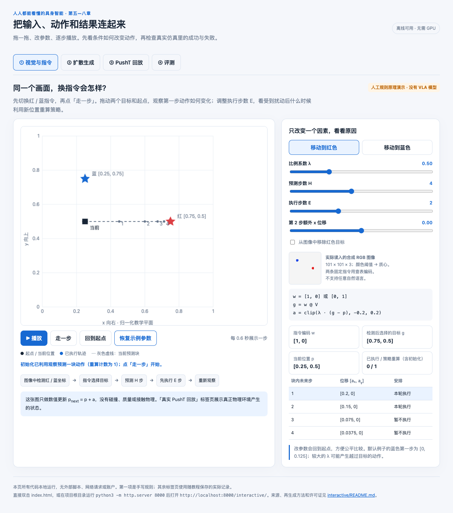

# 人人都能看懂的具身智能

面向会基础 Python、没有机器人背景的读者，用八章连起“观察 → 决策 → 动作 → 反馈”。先用小例子理解数学，再在成熟 PushT 仿真中运行公开预训练策略，最后读取真实日志判断成功与失败。

每章按“具体问题 → 直观解释 → 概念定义 → 数学与数值例子 → 代码 Demo → 结果解读 → 小练习”展开。主要章节保留 3 道练习及答案，公式说明符号、形状与代码对应。

## 八章导航

| 章节 | 学完应能解释什么 | 实践形式 |
| --- | --- | --- |
| [第一章——具身智能到底在做什么](第一章——具身智能到底在做什么.md) | 状态、观察、动作、策略、反馈与奖励 | 一维人工规则闭环 |
| [第二章——机器人如何表示位置与动作](第二章——机器人如何表示位置与动作.md) | 坐标、位置与位移、旋转、动作单位与归一化 | 坐标变换与图示 |
| [第三章——机器人如何从示范中学习](第三章——机器人如何从示范中学习.md) | 示范、轨迹、行为克隆、MSE 与梯度更新 | 实际训练小型行为克隆网络 |
| [第四章——从单步动作到动作序列](第四章——从单步动作到动作序列.md) | 预测多少步、执行多少步、何时利用新观察 | 动作窗口与滚动执行原理演示 |
| [第五章——Diffusion Policy 如何生成动作](第五章——Diffusion%20Policy%20如何生成动作.md) | 条件加噪、噪声损失、训练与采样的区别 | 实际训练小型条件噪声网络 |
| [第六章——VLA 如何连接视觉、语言与动作](第六章——VLA%20如何连接视觉、语言与动作.md) | 多模态条件、动作表示、训练与推理接口 | 人工规则连接演示与官方配置解析 |
| [第七章——跑通一个完整仿真任务](第七章——跑通一个完整仿真任务.md) | 如何连接图像观察、预训练策略、接触物理与评测 | 真实 PushT + 官方 Diffusion Policy 推理 |
| [第八章——判断机器人到底学会了什么](第八章——判断机器人到底学会了什么.md) | 成功率、覆盖率、泛化、泄漏与失败边界 | 读取第七章真实日志分析 |

第三、五章的小网络确实训练过；第四章没有训练 ACT，第六章没有训练或执行预训练 VLA。第七章使用上游已训练的策略，运行物理仿真与评测。每章分别写明验证范围，学习者自己的完成情况记在 [PROGRESS.md](PROGRESS.md)。

## 交互学习

打开 [interactive/index.html](interactive/index.html)，可以离线使用，不需要模型下载或云 GPU。

| 页面 | 可以自己操作什么 | 应当观察什么 |
| --- | --- | --- |
| 视觉与指令 | 换指令、拖动目标／起点、改变比例系数与预测／执行步数、播放或单步 | 同一图像为何产生不同动作；何时重新规划 |
| 扩散生成 | 滑动内部去噪进度，切换正确／打乱条件，播放已保存的生成过程 | 四个动作分量怎样从噪声变成动作；内部计算与执行的区别 |
| PushT 回放 | 选择实际条件与回合，播放或拖动环境步数 | 推杆的目标、真实接触、位置／朝向与覆盖率 |
| 评测 | 改变事后判读阈值或轨迹前缀预算，查看回合与成功率区间 | 评分规则怎样影响统计；改指标没有改变策略行为 |

网页把第六章的人工规则、第五章的真实小模型生成记录、第七章的真实物理轨迹分别标注。网页回放不重新推理，不把画布上的示意运动当作新的物理实验。

双击 HTML 即可打开；也可以在教程目录运行：

```bash
python3 -m http.server 8000 --bind 127.0.0.1
```

然后访问 `http://localhost:8000/interactive/index.html`。GitHub 的文件预览显示 HTML 源码；如希望读者直接在浏览器操作，可把同一文件用于 GitHub Pages 等静态托管。Pages 部署完成后使用实际网址，教程本身不预先假定已经发布。



## 运行完整仿真与分析

先按第七章安装隔离环境和下载公开权重。权重与上游源码放在用户缓存目录，教程仓库保留下载脚本、固定版本与结果，避免上传 1 GB 模型。

```bash
# 使用已经准备好的匹配环境；设备根据机器选择 mps、cuda 或 cpu
python demo/chapter07_setup.py
python demo/chapter07_pusht.py \
  --device mps --seeds 1000 --conditions 8 \
  --output results/chapter07_quick

# 先阅读附带的正式日志，重算表格与失败图
python demo/chapter08_evaluate.py
```

完整对照使用 [configs/chapter07.json](configs/chapter07.json) 的固定种子、执行时域与步数上限。修改配置后请另存输出，不覆盖教程中的正式记录；命令、设备和版本会记进日志。

## 可以补充体验的动态图网站

以下为作者或研究团队公开的交互材料。扩散、动量与四元数页面于 2026-10-05 核实，GARMI 页面于 2026-10-06 核实，均实际操作过主要控件；这些演示入口免费、无需登录。

- [TensorFlow Playground](https://playground.tensorflow.org/)：调网络结构、学习率与数据，配合第三章理解训练与测试损失。
- [LLM Visualization](https://bbycroft.net/llm)：观察语言模型中的数据流，配合第六章的 token、特征与模型结构理解。
- [Diffusion Explainer](https://poloclub.github.io/diffusion-explainer/)：拖动去噪进度、比较文字条件与生成过程，配合第五章。它演示图像扩散，动作空间和机器人评测需另行理解。
- [Distill：Why Momentum Really Works](https://distill.pub/2017/momentum/)：拖动起点、步长与动量，配合第三章的梯度更新选读。
- [Ben Eater／Grant Sanderson：四元数与三维旋转](https://eater.net/quaternions)：可操作的三维旋转视频，作为第二章选修，二维入门不要求先学四元数。
- [GARMI 双臂移动机器人](https://www.hyperturing.de/garmi/)：拖动蓝色手部目标、调整头部转角与身体高度，用 `W/A/S/D` 移动底盘、`Q/E` 转向。配合第二章理解空间目标、关节角、旋转与平移。页面运行实际接触物理和传统控制器，用于体验动作与坐标，没有在网页中训练机器人学习策略。

速学时任选一项玩 5～10 分钟即可：第三章改步长，第五章拖去噪进度，第二章拖动一个手部目标。外部网站是补充材料，教程中的数学、代码与正式结果仍以本地章节和记录为准。

## 文件与来源

`demo/` 保存可运行代码，`configs/` 保存实验方案，[requirements/](requirements/README.md) 集中保存依赖清单，`images/` 保存坐标图等素材，`results/` 保存实际生成的日志、图表和视频，`interactive/` 保存离线交互网页。章节末尾与结果目录的来源说明分别记录论文、官方实现、模型、数据和许可证。同步时保留这些目录；虚拟环境与外部模型缓存不需要上传。

复现优先以固定版本、脚本和原始日志为准。看到八章教程已经写好，只表示材料已经齐备；能独立解释核心公式、运行任务并分析失败，才是学习验收。
