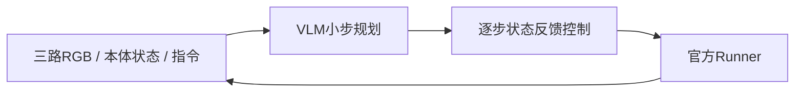

# 跨本体挑战赛：RGB3反馈控制 Baseline

2026跨本体具身认知极限联合挑战赛，历史成绩 **17.1028分**（初赛A）。同一策略控制R1 Lite / R1 Pro，无需本赛微调，不读取物体初始世界坐标或逐题路线表。

提交来源与复现边界见 [SCORE.md](SCORE.md)。

## 方案



- VLM每240控制步（2模拟秒）输出手部位移、旋转、夹爪开度和底盘目标速度。
- 每步使用实测状态重新计算误差，H=X=1；两种机器人共用代码和提示词。
- 最近4次计划与实测变化构成短记忆；底盘动作按“目标速度−实测速度”计算。
- 无本地动作模型或自训权重，**需要外部多模态API**。历史模型为`qwen3.8-omni-flash`。可尝试接入支持当前多图输入、非流式JSON输出和请求参数的兼容服务；Claude/GPT等其他模型的适配与得分尚未验证，更换后需重新评测。

可借鉴之处是三路视觉规划、目标速度与实测速度的反馈换算、跨本体共用接口及技术续跑入口。代码未使用物体初始世界坐标；机器人自身相对位姿参与反馈，也没有通过扰动实验测定泛化收益。

[policy.py](code/policy.py)与原始得分策略逐字节相同。共享版只整理启动、配置和文档，不包含后续微调实验。

## 运行

从[官方比赛页面](https://tianchi.aliyun.com/competition/entrance/532508)取得题包，按 [REPRODUCE.md](REPRODUCE.md) 安装固定环境并配置API。原始数据、运行结果及密钥不随仓库分发。

先在CPU检查源码完整性与接口（不调用API、不启动仿真）：

```bash
python tools/check.py --runner /data/robolab-benchmark30-dual-runner-rgb3-20260818-v2
```

正式运行30题×2本体并打包（使用已安装的RoboLab环境，参考官方群内提供的镜像）：

```bash
python code/reproduce.py \
  --archive /data/robolab-benchmark30-dual-runner-rgb3-20260818-v2.zip \
  --runtime-source /data/RoboLab \
  --work /data/v4-full --workers 8 --devices cuda:0 cuda:1 cuda:2 cuda:3
```

单卡使用`--workers 1 --devices cuda:0`。工作目录必须为空；默认每格7200步。入口只生成正式ZIP，不会上传官网。技术续跑、单格检查及输出位置见[复现指南](REPRODUCE.md)。

## 文件

|路径|用途|
|---|---|
|`code/`|得分策略、运行与技术续跑入口|
|`configs/`|无密钥配置、版本来源和哈希|
|`tests/`、`tools/check.py`|不使用GPU/API的接口检查|
|[SCORE.md](SCORE.md)|历史成绩及验证范围|

## 局限与许可

尚无可靠的抓放状态机、视觉目标追踪和长期记忆。60格轨迹技术有效不代表60题成功；历史成绩不是复跑保证。依赖外部API，未验证离线部署或Docker构建。

代码采用 [Apache-2.0](LICENSE)，第三方组件见 [NOTICE](NOTICE)。
