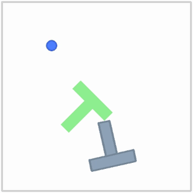

# 第七章——跑通一个完整仿真任务

前六章分别讲了闭环、坐标与动作、示范学习、动作块、扩散生成和视觉语言条件。本章把这些部分接起来：在 **PushT 推物仿真** 中读取观察，让预训练扩散策略控制圆形推杆，把 T 形物体推到目标轮廓，再保存回合与评测结果。

本章的完成标准是能运行一次完整回合，并说明图像、动作数值、物理执行与反馈怎样相连。第八章继续使用同一批日志，判断策略在哪些条件下成功、在哪些地方失败。

## 1. 具体问题：模型给出了两个数，为什么物体仍然没有到目标

一段网络代码能输出动作，不代表已经跑通机器人任务。我们还要确认：它输入了什么、两个数表示什么、环境怎样执行、什么时候重新观察、怎样判断任务完成。

PushT 中，圆形推杆通过接触推动 T 形物体。任务要求物体的位置和朝向都与目标匹配。仅仅把推杆移到物体中心，或者让物体中心靠近目标中心，都不能保证 T 形轮廓重合。

本章使用成熟的 [gym-pusht 环境](https://github.com/huggingface/gym-pusht)和公开的 [Diffusion Policy / PushT 权重](https://huggingface.co/lerobot/diffusion_pusht)。模型已由上游训练，本次工作是加载、推理、物理仿真与评测；第五章自己训练的小模型继续用于解释训练原理。

环境会返回奖励，但本次推理期间不根据奖励更新策略参数。它用于记录与评价任务表现，不能仅因出现奖励，就把这次运行称为强化学习训练。

## 2. 直观解释：相机看现场，策略给推杆落点，环境产生接触反馈

可以把圆形推杆想成桌面上的一个手指。策略给出“下一步手指想去的位置”，底层控制与物理环境决定它怎样移动，以及接触后 T 形物体怎样转动。

准确地说，PushT 通过二维刚体与接触求解模拟动作效果。**刚体（rigid body）** 是形状不变、可以平移与旋转的物体；**接触动力学（contact dynamics）** 用来计算碰撞、摩擦等对运动的影响。这里仍是简化仿真，不能直接替代实体机器人的验证。

```text
重置回合与随机种子
        ↓
读取图像 + 推杆位置，组成观察历史
        ↓
归一化 → 扩散策略生成动作块 → 恢复动作数值
        ↓
按顺序给环境发送一个绝对目标位置
        ↓
物理执行 → 新图像、位置、奖励与终止信息
        ↓
继续动作队列，或根据新观察生成下一块
        ↓
到达目标／超过步数预算 → 保存日志
```

图文演示入口是[交互学习页](interactive/index.html)的“PushT 回放”：选择回合、播放或拖动进度，观察推杆、物体、目标轮廓与覆盖率怎样变化。GitHub 文件浏览页显示 HTML 源码，交互需下载后用浏览器打开，或按 [README 的本地启动方法](README.md#交互学习)使用。它播放保存的真实仿真轨迹；重新生成策略动作仍由下面的 Python 程序完成。

## 3. 概念定义：环境、回合、策略与评测

| 名词 | 中文、英文及用途 |
| --- | --- |
| 环境 | environment：执行动作，产生新观察与反馈 |
| 回合 | episode：从一次重置开始，到成功或时间预算用完结束 |
| 随机种子 | random seed：固定随机过程的初始条件，便于复现 |
| 检查点 | checkpoint：保存的模型参数及配套配置 |
| 推理 | inference：参数固定，用输入生成动作 |
| 评测 | evaluation：在预先约定的条件、次数与指标下检查结果 |

Gymnasium 接口延续第一章：

```python
observation, info = env.reset(seed=seed)
observation, reward, terminated, truncated, info = env.step(action)
```

`terminated` 表示任务条件导致的回合结束，本环境主要是成功；`truncated` 表示达到步数上限等外部预算而结束。两者都应结束当前回合，但含义不同。[Gymnasium 官方接口](https://gymnasium.farama.org/api/env/)

### 两种观察要分清用途

第三章出现过位姿观察形式 `[推杆 x, 推杆 y, 物体 x, 物体 y, 物体角度]`，单样本形状 `(5,)`。这是环境提供的一种观察形式，也方便检查轨迹。接口虽然叫 `obs_type="state"`，这五个数仍未包含速度等全部物理信息；第一章的“完整环境状态”与这里的接口名字需要区分。

本章预训练视觉策略读取的是 **RGB 图像与二维推杆位置** 。T 形物体的位姿主要从图像中获取，不把分析日志中的五维位姿观察直接塞进策略。能记录物体的真实位置，不代表策略也获得了这项输入。

| 数据 | 本次单回合、批量为 1 的形状 | 用途 |
| --- | --- | --- |
| 当前 RGB 图像 | `(1, 3, 96, 96)` | 视觉观察 |
| 当前推杆位置 | `(1, 2)` | 自身位置观察 |
| 两帧图像历史 | `(1, 2, 3, 96, 96)` | 策略使用的观察历史 |
| 两帧位置历史 | `(1, 2, 2)` | 与图像历史对齐 |
| 完整动作预测窗口 | `(1, 16, 2)` | 生成与时间对齐 |
| 一个实际发送的动作 | `(2,)` | 推杆的绝对目标位置 |

## 4. 数学与手算：动作、时间与反馈怎样对应

### 4.1 本章动作是绝对位置

动作写作：

$$
a_t=[x_t^{\text{target}},y_t^{\text{target}}],
\qquad a_t\in[0,512]^2.
$$

 $t$ 是环境动作步； $x_t^{\text{target}}$ 与 $y_t^{\text{target}}$ 是本步推杆的目标坐标，组成形状 `(2,)` 的向量。场景坐标原点在左上，向右、向下为正；这里是仿真场景坐标单位，不是米。相机观察图是 `96 × 96`，不能直接把其像素编号当成 `0～512` 的动作坐标。

例如推杆当前在 `[100,150]`，策略输出 `[120,180]`，意思是“目标位置为 `[120,180]`”，期望位置差为 `[20,30]`。若把两个数错误地当作位移相加，会得到 `[220,330]`，动作语义就完全变了。

第一章与第六章用的是位移动作，所以写 `p_next = p + a`；本章需要调用 `env.step(a)`。实际位置由底层控制、接触与物理子步共同决定，不保证一步就精确等于目标坐标。

### 4.2 模型生成次数与环境动作次数不同

本次环境每个动作步对应 0.1 秒仿真时间，内部以 0.01 秒物理子步计算 10 次。设每次重新预测前执行 $E$ 步，则这一段覆盖的仿真时间为：

$$
\Delta t_{\text{execute}}=E\cdot0.1\ \text{秒}.
$$

 $E$ 是执行步数， $\Delta t_{\text{execute}}$ 是标量时间。本次主设置若 $E=8$ ，就覆盖 0.8 秒；对照 $E=4$ 覆盖 0.4 秒。它描述仿真动作时间，不包含电脑的模型推理耗时，也不等于内部去噪计算次数。

这份权重的完整预测窗口长 16，观察历史长 2。窗口从上一观察时刻开始，执行当前及未来动作要从索引 1 取起，主设置切片为 `predicted[:, 1:9]`，对照为 `predicted[:, 1:5]`。索引 0 不应作为当前动作发送。

第四章教学窗口直接从当前时刻开始，因此使用 `chunk[:E]`；这里多了与观察历史对齐的偏移。完整窗口的 16 个位置不能全都理解为“从现在起的 16 个未来动作”。[对应的官方策略实现](https://github.com/huggingface/lerobot/blob/3c0a209/lerobot/common/policies/diffusion/modeling_diffusion.py)

### 4.3 覆盖率、奖励与成功条件

令 $P_t$ 是物体当前占据的平面区域， $G$ 是目标轮廓区域，原始覆盖率为：

$$
c_t=\frac{\operatorname{Area}(P_t\cap G)}{\operatorname{Area}(G)},
\qquad r_t=\operatorname{clip}(c_t/0.95,0,1),
\qquad \text{success}_t=(c_t>0.95).
$$

 $\operatorname{Area}$ 表示面积， $\cap$ 表示两区域的交集； $c_t$ 与 $r_t$ 均为标量，范围为 `[0,1]`。覆盖率评价形状重合程度，奖励是环境对它进行缩放后的数值。本次固定环境的成功判断是 **严格大于 0.95** 。物体与目标为同一个 T 形，面积相等；这里只是在不同位置、朝向下比较。

手算：目标面积为 1,000，重叠面积为 900，则覆盖率为 0.9，奖励约为 `0.9 / 0.95 = 0.9474`，未成功。重叠面积为 960 时，覆盖率为 0.96，奖励裁到 1，成功。

特别注意，覆盖率刚好为 0.95 时，奖励已经等于 1，但严格成功条件尚未满足。因此程序读取环境的 `is_success`，并单独保存原始覆盖率，不能简单用 `reward == 1` 替代成功判定。README 的简述与具体版本实现有差异时，以实际运行的固定源码为准。

## 5. 代码 Demo：安装、观察示范、推理与评测

本次 Python 程序使用官方预训练网络与成熟物理环境，不采用前几章的人工位移规则。完整代码为 [chapter07_pusht.py](demo/chapter07_pusht.py)，固定评测方案为 [chapter07.json](configs/chapter07.json)，版本清单为 [requirements-chapter07.txt](requirements-chapter07.txt)。

### 5.1 安装一个与前几章分开的环境

本次分别验证了本机与云端的两条环境路径。**Torchvision** 提供图像处理与视觉网络，需与 PyTorch 成对匹配；**Pymunk** 提供本次二维物理计算。

| 环境路径 | 硬件与实际 Python／Torch 版本 | 用途 |
| --- | --- | --- |
| 本机 MPS | Apple M1、16 GB；Python 3.11.9、PyTorch 2.12.1、Torchvision 0.27.1 | 两个完整回合的环境与策略检查，另存开发记录 |
| 云端 CUDA | RTX 4090、24 GB；Python 3.11.13、PyTorch 2.7.1+cu128、Torchvision 0.22.1+cu128 | 正式固定对照的运行环境 |

两条路径的核心仿真依赖固定为 Gymnasium 0.29.1、gym-pusht 0.1.5、Pymunk 6.11.1、Diffusers 0.32.2；完整列表见 [requirements-chapter07-core.txt](requirements-chapter07-core.txt)。平台镜像名称只是选择入口，实际版本以程序记录为准。

普通读者可以从一个新虚拟环境开始，避免改动前三章的环境：

```bash
python3 -m venv .venv-chapter07
source .venv-chapter07/bin/activate
python -m pip install -r requirements-chapter07.txt
python demo/chapter07_setup.py
```

本机实际验证环境复用了已安装的同版本 PyTorch／Torchvision，并在独立环境中安装其余依赖；上面的完整清单给出了实际运行版本。本教程没有另外进行一次全新机器的安装测试，读者复现时仍应记录自己的系统与安装结果。

云端已有匹配的 PyTorch 2.7.1／Torchvision 0.22.1 时，保留它们并隔离安装核心依赖：

```bash
python3 -m venv --system-site-packages .venv-chapter07-cuda
source .venv-chapter07-cuda/bin/activate
python -m pip install -r requirements-chapter07-core.txt
python demo/chapter07_setup.py
```

CUDA 版本清单另存 [requirements-chapter07-gpu.txt](requirements-chapter07-gpu.txt)。不要把本机的 Torch／Torchvision 版本清单直接用于云端。若从没有预装 Torch 的 GPU 环境开始，应先按[官方版本安装说明](https://pytorch.org/get-started/previous-versions/)安装匹配版本，例如本次使用的 CUDA 12.8 路径：

```bash
python -m pip install torch==2.7.1 torchvision==0.22.1 \
  --index-url https://download.pytorch.org/whl/cu128
python -m pip install -r requirements-chapter07-core.txt
```

这是新环境的准备路径；本次实际复用了镜像预装 Torch。仅从普通 PyPI 安装相同逻辑版本号，可能得到另一 CUDA 构建，仍需把实际版本记入日志。

下载脚本把官方源码和约 1.05 GB 的权重放在 `~/.cache/embodiedai-chapter07/`，不会把它们复制进教程仓库。源码固定为训练模型时使用的 LeRobot 提交 `3c0a209f9fac4d2a57617e686a7f2a2309144ba2`，模型固定 revision 为 `84a7c23178445c6bbf7e1a884ff497017910f653`。这条路径避免把旧权重直接交给接口已变化的最新 LeRobot。

源码与模型的架构参数保持一致。Hub 配置中后来加入的 `type`、`device`、`use_amp` 三个运行字段会被明确排除；其他未知字段会报错。权重加载采用严格匹配，缺失或多余参数都会报错，而不是悄悄跳过。

### 5.2 观察示范数据与本次模型的关系

模型卡说明它使用 [lerobot/pusht 示范数据](https://huggingface.co/datasets/lerobot/pusht)进行模仿学习。本次不重新训练这份策略，但实际读取并保存了数据的字段与前 5 行数值，见 [sources/](results/chapter07/sources/)。

本次读取的示范快照中，`observation.state` 为二维推杆位置，`action` 是二维绝对目标位置，视觉信息另外保存在图像字段中。第三章五维示例对应环境 `obs_type="state"` 的另一种观察形式；字段名字相同，不表示维度和内容一定相同。

已读取的第一行推杆位置为 `[222,97]`，专家动作为 `[233,71]`；下一行推杆位置约为 `[225.2524,89.3125]`，专家动作为 `[229,83]`。专家动作是推杆下一目标，观察位置记录实际结果，两者没有必要相等。

第三章把专家动作用作监督标签，第四章把连续标签整理成窗口，第五章学习条件生成。本章加载的是已经完成上游训练的视觉策略；读取示范样例只是核对数据接口，没有把未来专家动作传给当前仿真策略。

### 5.3 先运行一个回合，再运行固定对照

在 Apple GPU 上先跑一组；如果机器没有 MPS，可把 `mps` 换成 `cpu`，但速度需要另行测量：

```bash
python demo/chapter07_pusht.py \
  --device mps --seeds 1000 --conditions 8 \
  --output results/chapter07_quick
```

再按配置评测两个设置的全部固定种子：

```bash
python demo/chapter07_pusht.py \
  --device mps --output results/chapter07_repeat
```

如果进程中断，使用同一目录与相同配置继续已完成回合之后的工作：

```bash
python demo/chapter07_pusht.py \
  --device mps --output results/chapter07_repeat --resume
```

本机推理每块需要数秒，完整对照需要比单个回合更多时间。先确认一个回合跑通，再把长评测安排为无人值守计算；主动学习与分析仍可分在两次、不超过 2 小时的学习时段中。`--max-steps` 可以缩短个人试运行，但缩短后的结果与本章 300 步协议不同，不能混进正式表格。

若使用已配置好 NVIDIA GPU 的机器，把设备改为 `cuda`；虚拟环境与 PyTorch／Torchvision 必须匹配。短期推理可以先设置 10 元以内的预算，安装和下载时间也计入实际使用时长，保存结果后删除新建实例。本次租用、最终费用与清理情况见实验记录。

核心闭环与公式的对应如下；完整脚本另外处理观察历史、动作队列、日志和视频：

```python
batch = to_batch(observation, device)  # 图像 HWC → BCHW，推杆位置 → (1, 2)
with torch.inference_mode():
    action = policy.select_action(batch).squeeze(0).cpu().numpy()
observation, reward, terminated, truncated, info = env.step(action)
success = info["is_success"]           # 采用环境定义
```

网络内部每步都更新最近两次观察，但有缓存动作时仍继续执行原队列；每 $E$ 步队列耗尽，才根据最近两帧重新生成。回合刚开始没有上一帧时，官方队列重复当前观察填满历史，不会读到尚未发生的未来图像。视频与物体位姿真值用于事后解释，策略输入仍只有图像和推杆位置。

### 5.4 先找回合日志，再找汇总指标

每个回合都会保存：

- 轨迹 JSON：执行的目标位置、实际状态、原始覆盖率、奖励、重新预测时刻与终止标记。
- MP4 视频和初始／最佳／最终帧 PNG。
- `evaluation.json`：逐回合成功标记、最大与最终覆盖率、步数、推理次数、设备与版本等。

轨迹的第 0 项是初始状态，还没有动作，所以 `action` 为 `null`；它的 `reward=0` 仅为日志占位，`env.reset` 本身不返回奖励。第 4.3 节的奖励式对应 `env.step` 后的动作步。执行 $T$ 步后有 $T+1$ 项状态记录，已执行动作数组则有 $T$ 行。第八章分析这些日志，不重新运行模型。

## 6. 结果解读：只改变一个因素的对照

正式实验在同一 RTX 4090 上串行运行：每组使用种子 1000～1009，最多 300 个动作步，批量为 1，float32，100 次 DDPM 去噪。两组只改变执行时域：主设置 E8、对照 E4；权重、环境、初态种子、预算与成功定义相同。

每次重新预测的噪声种子按 `100000 + 环境种子 × 1000 + 当前环境步` 设置。因此两组在相同时间步重新生成时，使用相同噪声种子；重新生成的时间安排不同，后续轨迹仍会不同。

第八章脚本进一步核对 10 对回合：初始位姿、前 4 个动作、执行前 4 个动作后的状态差都为 0。因为 E4 到第 5 个动作前才重新预测，前四步相同是这组对照应有的结果。这是实现检查，不是保证后续轨迹相同。

| 条件 | 成功 / 总回合 | 成功率 | 平均最大原始覆盖率 | 平均最终原始覆盖率 | 平均动作步数 |
| --- | ---: | ---: | ---: | ---: | ---: |
| 执行 8 步后重新生成 | 7 / 10 | 70% | 0.907874 | 0.907585 | 193.4 |
| 执行 4 步后重新生成 | 2 / 10 | 20% | 0.913802 | 0.910880 | 278.8 |

结果来自 [evaluation.json](results/chapter07/evaluation.json)，表格由 [第八章分析脚本](demo/chapter08_evaluate.py)核对并生成；逐回合表见 [RESULTS.md](results/chapter08/RESULTS.md)。

**这组实验中，执行 8 步的成功率更高；执行 4 步的平均最大覆盖率却略高。** 更早使用新观察不保证更高成功率；覆盖率的平均值也不能代替任务成功率。第八章会解释这个看起来矛盾的结果。

### 6.1 先看一个实际成功回合

按预定顺序选出的首个成功回合是 E8／seed 1000，执行 138 步后覆盖率达到约 0.969140，环境返回成功：



蓝色圆是推杆，灰色 T 块是物体，绿色轮廓是目标。红色十字是可视化叠加的动作目标；它没有加入策略读取的相机观察。动作目标与推杆实际位置不必相等，接触位置与 T 块朝向都影响覆盖率。

GIF 由同一回合的完整视频抽帧生成，显示完整 0～138 步，宽 320、约 3 帧／秒；原始视频按 10 帧／秒仿真节奏保存。它没有把每次推理等待都录成静止画面，所以视频的播放时间不能当作程序实际耗时。[完整 MP4](results/chapter07/videos/E8_seed1000.mp4)、[GIF 来源与抽帧记录](results/chapter07/videos/representative_success.json)

另一个 E8／seed 1004 回合在 300 步预算内未成功，最高覆盖率约 0.928778。第八章将它作为按固定顺序选出的首个失败案例；完整失败回放保留，没有从成绩表中删除。

### 6.2 计算成本与复现边界

这次完整推理进程耗时约 1,690.43 秒，即 28 分 10 秒，包含加载策略和运行全部 20 回合，不包含环境安装、权重下载或传输结果；计时方法与起止时间见 [process_timing.json](results/chapter07/process_timing.json)。

两组每回合平均墙钟耗时约 44.28 秒与 123.40 秒；执行 4 步时更频繁生成，同时这组成功较少、更多回合用满预算，所以不能把总耗时差全归给一次推理速度。**墙钟时间（wall-clock time）** 是电脑实际经过的时间，区别于第 4 节的仿真时间。

本次在[算力自由](https://www.gpufree.cn/market)按 1.38 元／小时租用云实例，账单实际支付 **1.19 元**，额外付费磁盘为 0。结果收回并校验后，实例已经关机、释放；记录见 [gpu_instance_record.json](results/cloud/gpu_instance_record.json)。这是 2026-10-05 本次账单，读者自己的时间与费用取决于硬件、当时价格、网络、安装过程和回合长度，不照搬本次耗时。

本机 MPS 的两个完整回合仅用于环境检查，保存在 `development_mps/`，没有混入正式 CUDA 表格。不同设备的随机数与数值计算可能有差别；可以复现同一流程，但不能要求 MPS 与 CUDA 每个动作都逐项相等。正式对照始终在同一设备、同一版本组合下完成。

本次检验的是固定权重、固定仿真与 10 对种子的表现，不是完整复现上游论文或模型卡的 500 回合评测。模型卡的 `avg_max_reward` 与本章明确记录的原始几何覆盖率也应先核对口径，再作比较。

## 7. 小练习（全章共 3 题）

1. 推杆当前位置为 `[80,120]`，策略输出绝对目标位置 `[110,140]`。动作应该原样发送什么？期望位置差是多少？
2. 每个动作步对应 0.1 秒，重新预测前执行 4 步。覆盖多少秒仿真时间？这是否说明电脑一定在 0.4 秒内完成了推理？
3. 目标面积为 2,000，当前重叠面积为 1,920。覆盖率、环境奖励分别是多少？按本章固定环境的条件是否成功？

### 参考答案（先独立作答，再对照）

1. 原样发送 `[110,140]`，期望位置差为 `[30,20]`。绝对目标位置不能再加到当前位置上。
2. `4 × 0.1 = 0.4` 秒仿真时间。它不是电脑推理耗时，推理需要单独计时。
3. 覆盖率为 `1920 / 2000 = 0.96`；奖励为 `clip(0.96 / 0.95, 0, 1) = 1`；因为 `0.96 > 0.95`，成功。

## 8. 来源、许可与复现边界

核查日期：2026-10-05。本章选择公开的经典 PushT 任务与扩散策略深入实践，沿用两周主线；VLA 保留在第六章做概念与接口学习。

1. [Diffusion Policy 原论文](https://arxiv.org/abs/2303.04137)、[作者项目页](https://diffusion-policy.cs.columbia.edu/)：观察条件下的动作生成与滚动执行。原作者代码为 MIT；本章实际运行的是 LeRobot 实现。
2. [固定模型 revision](https://huggingface.co/lerobot/diffusion_pusht/tree/84a7c23178445c6bbf7e1a884ff497017910f653)、[固定 LeRobot 源码](https://github.com/huggingface/lerobot/tree/3c0a209f9fac4d2a57617e686a7f2a2309144ba2)：模型与该实现标注 Apache-2.0，保存的模型卡明确说明训练时使用该提交。权重约 1.05 GB，SHA-256 为 `995d14d35db57d95c35ad9704c3d79c8612b7bc45f3877e5c46c2cdc516856a8`。
3. [gym-pusht 0.1.5 发布包](https://pypi.org/project/gym-pusht/0.1.5/)、[固定依赖说明](https://github.com/huggingface/lerobot/blob/3c0a209f9fac4d2a57617e686a7f2a2309144ba2/pyproject.toml)：环境为 Apache-2.0。本次实际发布 wheel 的 SHA-256 为 `d9e3ba5f44916dc4a802d71764b08f4e7e09bda256e25af9dda16e9364dc777f`；其中 `gym_pusht/envs/pusht.py` 第 232～263 行定义本章面积比、奖励与成功阈值，源码文件 SHA-256 为 `d82ff093bcb01ccc21adedfb5545f435e9eb1fbdbba4f103768b0a8a23725f8f`。
4. [示范数据集](https://huggingface.co/datasets/lerobot/pusht)：当前数据卡标注 MIT，不能因模型与环境是 Apache-2.0，就把数据许可也改成相同许可。本次前 5 行来自当时的公开 first-rows 服务；它不是按 revision 下载的原始训练数据，不能声称当前快照就是该权重训练时的精确版本。读取日期、当时 revision 和限制记在 [dataset_provenance.json](results/chapter07/sources/dataset_provenance.json)。
5. [Gymnasium 官方接口](https://gymnasium.farama.org/api/env/)：重置、动作执行、任务终止与预算截断。

截至核查日，gym-pusht 最新已发布版本为 0.1.6，GitHub 有 2026-09-17 的维护提交；LeRobot 有 2026-10-03 的维护提交。本章冻结旧版本是为了保留已实测的复现组合，没有断言新版不能运行。升级属于另一组需要验证的配置。[环境维护记录](https://github.com/huggingface/gym-pusht/commit/86a8871e2d9812394cb302792a9727e9b819bf11)、[LeRobot 维护记录](https://github.com/huggingface/lerobot/commit/8c920c4270460851cedd2737657584586d3dc66f)

本章视频、PNG 和轨迹来自实际 `env.reset`、`env.step` 与 `env.render`；GIF 由同回合视频缩小与抽帧生成，不是重新运行的实验。交互网页用同一批状态记录重绘，不在浏览器中重新计算物理或策略。

许可证与模型卡保留在 [sources/](results/chapter07/sources/) 中。本教程新编写的连接、日志和分析代码不等于上游训练代码。上传 GitHub 时连同脚本、配置、依赖清单、日志、图片、视频与许可文件一起保存；大型权重和源码缓存留在下载脚本指定的位置。
