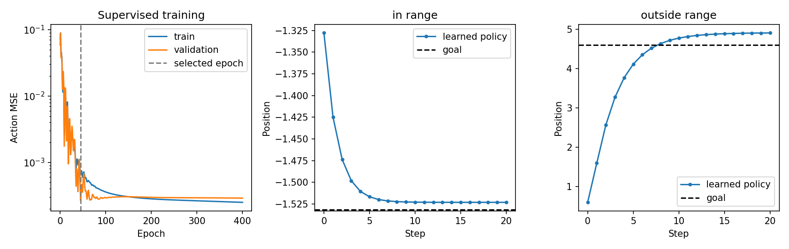

# 第三章——机器人如何从示范中学习

第一章用人工规则完成了“观察 → 动作 → 新观察”的闭环；第二章规定了动作的坐标系、单位和归一化。本章保留这些约定，学习怎样用示范数据训练策略，替代人工写规则。

先分清两件事：**训练时**读取专家数据，调整模型参数；**执行时**让模型根据最新观察产生动作，进入第一章的闭环。本章 Demo 会实际训练小模型，但使用一维简化环境。真正的 PushT 物理仿真在第七章汇总。

## 1. 具体问题：机器人怎样模仿人的操作

假设人类专家控制推杆，把方块推向目标。系统在每个时间步记录：

- 专家看到了什么；
- 专家执行了什么动作。

例如：

```
观察：[推杆位置、方块位置、方块角度]
动作：[推杆下一个目标位置]
```

收集很多这样的示范后，我们训练模型回答：

> 专家看到这个观察时，会执行什么动作？

这种学习方法叫做**行为克隆（Behavior Cloning，BC）**。

“行为”是专家的动作，“克隆”是让模型模仿专家从观察到动作的映射。

直观上像“看老师怎么做，再练习预测老师下一步会怎么做”。准确地说，行为克隆是一种**监督学习（supervised learning）**：专家动作是已知的正确答案，模型通过预测误差更新参数。它是**模仿学习（imitation learning）**的一种方法；模仿学习还包含执行过程中向专家补采示范等方法。

## 2. 什么是轨迹

机器人从任务开始到结束的交互过程称为**回合（episode）**，其中按时间排列的观察与动作记录称为**轨迹（trajectory）**。轨迹也可以只记录一个回合中的一部分，本章使用完整回合。

一条轨迹可以写成：

$$
 \tau= (o_0,a_0,o_1,a_1,\ldots,o_{T-1},a_{T-1},o_T) 
$$

其中：

- $\tau$：一条轨迹；
- $T$：这条轨迹包含的动作步数；
- $o_t$：第 $t$ 步的观察；
- $a_t$：专家在第 $t$ 步执行的动作；
- $o_T$：执行最后一个动作后得到的观察。

为什么最后只有 $o_T$，没有对应的 $a_T$？

因为轨迹在这里已经结束，不再需要执行下一个动作。也可以根据具体数据格式，只保存配对的 $(o_t,a_t)$。

假设 PushT 使用状态观察：

$$
 o_t= [ x_t^{agent}, y_t^{agent}, x_t^{block}, y_t^{block}, \theta_t^{block} ] 
$$

那么：

```
o_t.shape = (5,)
```

动作是推杆的目标位置：

$$
 a_t=[x_t^{target},y_t^{target}] 
$$

因此：

```
a_t.shape = (2,)
```

这里沿用第二章的 PushT 动作约定：两个分量是推杆的**绝对目标位置**，不是物体的位移或施加的力。记录样本时要把 $o_t$ 与当时选择的 $a_t$ 配对，不能错误地配成动作执行后的 $o_{t+1}$ 与 $a_t$。

## 3. 从多条轨迹组成数据集

假设我们收集了 $N$ 条专家轨迹：

$$
 \mathcal{D}=\{\tau_1,\tau_2,\ldots,\tau_N\} 
$$

不同轨迹的长度可能不同：

```
轨迹 1：8 步
轨迹 2：12 步
轨迹 3：10 步
```

训练单步行为克隆时，可以把所有时间步展开成观察—动作样本：

$$
 \mathcal{D}_{BC} = \{(o_i,a_i)\}_{i=1}^{M} 
$$

这里：

- $N$ 是轨迹数量；
- $M$ 是所有轨迹的动作步数之和；
- 每个 $(o_i,a_i)$ 都是一条监督学习样本。

如果一共有 $M=1000$ 个时间步，观察维度为 5，动作维度为 2，那么：

```
observations.shape = (1000, 5)
actions.shape      = (1000, 2)
```

数据较多时，训练通常取包含 $B$ 个样本的小批量；数据很少时也可以一次使用全部样本。本章的简化 Demo 采用后者。

```
batch_observations.shape = (B, 5)
batch_actions.shape      = (B, 2)
```

例如 `B=32`：

```
batch_observations.shape = (32, 5)
batch_actions.shape      = (32, 2)
```

可以把数据看成表格：**一行是一个时间步的样本，一列是一个特征**。`(5,)` 和 `(2,)` 是一行样本的形状，整个数据集还要在前面加样本数量。例如三条轨迹有 4、6、5 个动作时间步，总共 $M=15$ 行，得到 `(15, 5)` 和 `(15, 2)`。

划分训练集、验证集和测试集时，先按**完整回合**分组，再展开时间步，避免同一轨迹中相邻、极其相似的样本同时进入训练与测试。训练集用于更新参数；验证集用于选择模型；测试集留到最后评测。归一化参数若需要从数据估计，也只能由训练集计算，并在验证、测试和执行时复用。

## 4. 行为克隆在学习什么

策略模型记作：

$$
 \hat a_i=\pi_\theta(o_i) 
$$

其中：

- $\pi$：策略模型；
- $\theta$：模型中所有可训练参数；
- $o_i$：第 $i$ 个观察；
- $\hat a_i$：模型预测的动作；
- $a_i$：专家真实动作。

训练目标是让预测动作 $\hat a_i$ 尽可能接近专家动作 $a_i$。

这里省略目标输入的前提是**任务目标固定**。如果目标会变化，必须与第一章一样写成 $\hat a_i=\pi_\theta(o_i,g_i)$，或把目标并入输入 $\tilde o_i=[o_i,g_i]$。不能让相同观察对应两个目标，却不告诉模型当前目标是什么。

最简单的线性策略可以写成：

$$
 \hat a_i=Wo_i+b 
$$

若观察维度是 5、动作维度是 2，则：

```
o_i.shape = (5,)
W.shape   = (2, 5)
b.shape   = (2,)
a_hat.shape = (2,)
```

批量计算时：

$$
 \hat A=OW^\mathsf{T}+b 
$$

形状变化为：

```
O.shape   = (B, 5)
W.T.shape = (5, 2)
b.shape   = (2,)
A_hat.shape = (B, 2)
```

偏置 $b$ 会自动加到批量中的每一行动作上。

真实任务通常使用神经网络代替线性函数，但输入、输出和损失的基本关系相同。

第一章和第二章中的 $\theta$ 也可能表示角度；本节下标 $\theta$ 专指**模型参数集合**，不是机器人姿态角。本节五维观察的线性例子假设固定目标；后面的 Demo 输入为一维位置和目标，维度为 2。

## 5. 用均方误差评价动作预测

对于连续动作，最简单的损失函数是**均方误差（Mean Squared Error，MSE）**：

$$
 L(\theta) = \frac{1}{B d_a} \sum_{i=1}^{B} \sum_{j=1}^{d_a} (\hat a_{ij}-a_{ij})^2 
$$

其中：

- $L(\theta)$：当前模型的平均损失；
- $B$：批量样本数量；
- $d_a$：动作维度，PushT 中为 2；
- $\hat a_{ij}$：第 $i$ 个样本预测动作的第 $j$ 维；
- $a_{ij}$：对应的专家动作；
- 平方可以防止正负误差互相抵消。

### 手算例子

专家动作是：

$$
 a=[1,-1] 
$$

模型预测：

$$
 \hat a=[0.5,-0.5] 
$$

误差为：

$$
 \hat a-a=[-0.5,0.5] 
$$

分别平方：

$$
 (-0.5)^2=0.25,\qquad 0.5^2=0.25 
$$

两维取平均：

$$
 L=\frac{0.25+0.25}{2}=0.25 
$$

因此这个样本的 MSE 是：

$$
 \boxed{0.25} 
$$

MSE 越小，只能说明模型在这些数据上的动作预测越接近专家；它不直接等于仿真成功率。

注意：$[-0.5,0.5]$ 是**误差向量**，不是 MSE。MSE 要经过“每一维平方 → 相加 → 除以元素数量”，结果是一个**标量**，张量形状为 `()`。PyTorch 中 `loss = ((prediction - target) ** 2).mean()` 就是这条公式。

本例将动作视为已按统一规则缩放后的连续数值。第二章讲过，训练和执行必须使用同一套归一化规则，必要时先反归一化再发送给环境。MSE 对分量尺度敏感：米、角度等不同单位混在一起时，要先规定缩放或权重。这里暂不处理多种正确动作对应同一观察的情况；MSE 可能把不同示范动作平均成不可取的中间动作。

## 6. 梯度更新在做什么

先用一个输入、一个输出、两个可训练参数 $w$ 和 $b$ 的线性模型理解：

这是独立的标量回归手算例子，暂不设动作上下限；下面的目标数值 5 不属于前文归一化动作 $[-1,1]$ 的例子。

$$
 \hat a=wo+b 
$$

损失为：

$$
 L=(\hat a-a)^2 
$$

梯度描述损失对参数的小幅变化有多敏感，梯度下降沿减小损失的方向更新参数。下面两个偏导数都要用**更新前**的同一组参数计算；不用手工求复杂神经网络的导数，PyTorch 可通过 `loss.backward()` 自动计算。本节公式供手算，完整推导可以作为选修。

根据链式法则：

$$
 \frac{\partial L}{\partial w} = 2(\hat a-a)o 
$$

$$
 \frac{\partial L}{\partial b} = 2(\hat a-a) 
$$

使用学习率 $\eta$ 更新参数：

$$
 w\leftarrow w-\eta\frac{\partial L}{\partial w} 
$$

$$
 b\leftarrow b-\eta\frac{\partial L}{\partial b} 
$$

假设：

$$
 o=2,\quad a=5,\quad w=1,\quad b=0,\quad\eta=0.05 
$$

更新前预测：

$$
 \hat a=1\times2+0=2 
$$

损失：

$$
 L=(2-5)^2=9 
$$

梯度：

$$
 \frac{\partial L}{\partial w} = 2(2-5)\times2=-12 
$$

$$
 \frac{\partial L}{\partial b} = 2(2-5)=-6 
$$

更新后：

$$
 w=1-0.05\times(-12)=1.6 
$$

$$
 b=0-0.05\times(-6)=0.3 
$$

再次预测：

$$
 \hat a=1.6\times2+0.3=3.5 
$$

新损失：

$$
 L=(3.5-5)^2=2.25 
$$

损失从 9 降到了 2.25，说明这次更新使预测更接近专家动作。

其中 $\eta$ 是**学习率（learning rate）**，控制参数每次更新的步长，`0.05` 对应代码中的 `lr`。较大的学习率不保证每步都降低损失，步长过大可能越过较优参数。

## 7. 行为克隆和强化学习的区别

| 对比           | 行为克隆            | 强化学习                   |
| -------------- | ------------------- | -------------------------- |
| 学习来源       | 专家的观察—动作示范 | 与环境交互得到的奖励       |
| 直接目标       | 模仿专家动作        | 最大化长期累计奖励         |
| 是否必须有奖励 | 不必须              | 通常必须                   |
| 是否需要探索   | 训练时通常不需要    | 通常需要                   |
| 主要难点       | 示范质量、分布偏移  | 探索、奖励设计、训练稳定性 |

两者不是互斥的。实际机器人系统可以先用行为克隆学习一个初始策略，再使用强化学习继续优化。

## 8. 行为克隆最常见的失败原因

训练数据主要来自专家访问过的状态。

模型执行时如果犯了一个小错误，就可能进入专家示范中从未出现的状态。模型不知道如何恢复，又会继续犯错，误差可能逐步累积。这称为**分布偏移（distribution shift）**或误差累积。

训练损失通常只比较“专家提供的观察”和“对应的专家动作”，**并不让机器人按专家轨迹现场执行**。而闭环评测时，下一步观察来自模型自己执行动作后的环境，可能偏离训练数据。因此离线训练误差小，也不能证明新状态下的恢复能力。下面的 Demo 检查超出训练范围时的表现，但这只是分布偏移的一种，不能单凭它证明所有误差累积问题。

所以：

> 训练损失很低，不代表机器人闭环执行一定成功。

后面的实验必须分别检查：

- 训练数据上的动作误差；
- 未见初始位置上的动作误差；
- 闭环执行的任务成功率；
- 策略失败后能否恢复。

## 9. 代码 Demo：从第一章人工策略中学习

> **Demo 类型：实际训练的原理演示。** 使用第一章人工策略生成合成示范；不是人类遥操作数据，也没有运行 PushT。

人工专家给出的动作和环境变化与第一章相同：

$$
a_t=\mathrm{clip}(0.5(g-x_t),-1,1),\qquad x_{t+1}=x_t+a_t.
$$

为了训练，随机生成 60 个初始位置和目标，范围都为 $[-2,2]$，每个回合记录 12 个观察—动作对。按回合划分成 32 个训练回合、8 个验证回合和 20 个测试回合。

输入包含当前位置 $x_t$ 和目标 $g$，并按预先规定的尺度除以 2；动作是一步位移，已限制在 $[-1,1]$，无需反归一化。本章 Demo 的动作含义与第一章一致，和第二章 PushT 的绝对位置动作不同。

$$
\tilde o_t=[x_t/2,g/2],\qquad \hat a_t=\pi_\theta(\tilde o_t).
$$

训练数据形状为 `(384, 2)`，动作形状为 `(384, 1)`，因为 $32\times12=384$。末尾的 `1` 必须保留，否则 `(384,)` 可能通过广播与 `(384,1)` 错误地形成两两比较。

模型采用**多层感知机（Multilayer Perceptron，MLP）**，即多个线性层和非线性函数组成的神经网络。它有两个输入、两个各 32 个单元的隐藏层和一个动作输出。`Tanh` 非线性函数把每个数映射到 $(-1,1)$，让模型能拟合第一章带动作截断的非线性规则。

完整代码：[demo/chapter03_bc.py](demo/chapter03_bc.py)。在本章目录中运行：

```bash
python3 demo/chapter03_bc.py
```

若本机缺少依赖，可在独立虚拟环境中安装：

```bash
python3 -m venv .venv
source .venv/bin/activate
python -m pip install torch==2.12.1 matplotlib==3.10.3
python demo/chapter03_bc.py
```

本机已验证 Python 3.11.9，使用 CPU；这组版本是本次实验的运行记录，并非要求所有后续策略都沿用它。

训练循环的核心代码如下。`Adam` 是一种自动调整更新步长的优化器；它同样使用梯度，但更新规则比前面的手算梯度下降复杂。

```python
prediction = model(train_x)              # (384, 1)
loss = loss_fn(prediction, train_a)        # MSE 标量，形状 ()
optimizer.zero_grad()                     # 清除上一次梯度
loss.backward()                          # 自动计算每个参数的梯度
optimizer.step()                         # 根据梯度更新参数
```

训练完成后选择验证 MSE 最小的模型，再让模型在一维环境中闭环执行 20 步。成功标准是最终误差小于 `0.1`。测试初始条件保留为 20 个未参与训练或选模型的回合；另将同一组初始位置和目标同时乘以 3，检查范围外的表现。两组都复用相同模型、输入缩放、动作上限和执行步数。

结果写入 `results/chapter03/`：`metrics.json` 保存指标和示例轨迹，`loss_history.json` 保存损失记录，`rollouts.json` 保存两组共 40 条完整执行轨迹，`policy.pt` 保存参数，`training_and_rollouts.png` 保存图表。固定随机种子为 7；不同软件或硬件上数值可能略有差异。

## 10. 结果解读

本机运行 400 轮后，验证误差最小的模型来自第 45 轮。下表来自实际生成的 [metrics.json](results/chapter03/metrics.json)，MSE 是动作数值的平均平方误差：

| 指标 | 本次结果 |
| --- | --- |
| 训练前的训练 MSE | 0.073173 |
| 选中模型的训练 MSE | 0.000649 |
| 选中模型的验证 MSE | 0.000267 |
| 未见回合的专家观察上的测试 MSE | 0.000500 |
| 原范围内闭环成功率 | 20/20（100%） |
| 初始位置和目标放大 3 倍后的闭环成功率 | 12/20（60%） |

左图显示训练和验证误差，灰色虚线标出选中的第 45 轮。最后一轮的训练误差更低，但验证误差不是最低，因此没有直接使用最后一轮参数。中图是原范围内第一个测试回合，右图是放大后的 20 个测试回合中**最终误差最大**的一个。



右图失败案例的初始位置约为 $0.5933$，目标约为 $4.6006$；20 步后停在 $4.9114$，最终误差约为 $0.3108$，没有达到小于 $0.1$ 的成功标准。模型在目标附近仍给出向右动作，最后偏离目标。专家公式在到达或超过目标时应给出零或反向动作；当前模型在这个未见目标范围上没有完全学到这条规则。

这组测试同时改变了初始位置与目标的尺度，是一个范围外测试，不适合用来分别归因于位置或目标。它也不是后续完整 PushT 项目的性能报告；20 个回合只是本章教学测试。当前失败说明需要评测范围外和闭环执行，不能推断所有行为克隆模型都会失败。

## 11. 小练习（全章共 3 题）

1. 三条轨迹分别包含 4、6、5 个动作时间步。观察维度为 5，动作维度为 2。把它们展开后，`observations` 和 `actions` 的形状分别是什么？
2. 专家动作是 $[1,-1]$，模型预测是 $[0.5,-0.5]$。先写误差向量，再计算 MSE。
3. 行为克隆在专家数据上的 MSE 很低，但机器人执行时稍微偏离专家轨迹后连续失败。这更可能是什么问题？为什么仅看训练损失发现不了它？

### 参考答案（做完再对照）

1. 样本数量是 $4+6+5=15$，所以 `observations.shape = (15, 5)`，`actions.shape = (15, 2)`。`(5,)`、`(2,)` 只表示一个时间步的数据。
2. 误差向量为 $[-0.5,0.5]$，平方后为 $[0.25,0.25]$，平均值为 $0.25$。MSE 是一个数，不是向量。
3. 可能是分布偏移和误差累积。训练只在保存的专家观察上计算动作误差；闭环执行产生的新观察可能不在这些数据中，训练损失没有评测这些新观察和任务成功率。

## 12. 来源与许可

- [PyTorch MSELoss](https://docs.pytorch.org/docs/stable/generated/torch.nn.MSELoss.html)：默认对输入中的全部元素取平均，本章公式对应 `reduction="mean"`。
- [PyTorch 参数优化教程](https://docs.pytorch.org/tutorials/beginner/basics/optimization_tutorial.html)：反向传播、梯度清零与参数更新。
- [Ross、Gordon、Bagnell，2011，DAgger 原论文](https://proceedings.mlr.press/v15/ross11a.html)：学习策略执行后访问的状态分布与专家示范分布不同的问题；本章只解释现象，不实现 DAgger。
- [Hugging Face gym-pusht](https://github.com/huggingface/gym-pusht)：第二章到本章五维观察、二维绝对位置动作的定义，上游采用 Apache-2.0 许可证。

本章 Demo、合成示范与图表为本教程生成；没有下载或复制上游示范数据。PyTorch 采用 BSD-3-Clause，Matplotlib 使用其项目许可证；使用这些依赖时遵守相应许可。本章是经典行为克隆基础，第四章开始连接动作分块、第五章连接扩散策略。
