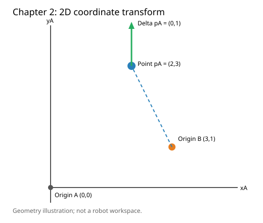

# 第二章——机器人如何表示位置与动作

这一章要解决一个具体问题：

> 相机说方块在它的右前方，机器人怎样把这个位置转换成自己能够执行的动作？

本章先看二维坐标，再把位置变换连接到动作空间与归一化。三维空间还需处理三维旋转和姿态，本章不展开。

## 1. 一个位置必须属于某个坐标系

假设有人只告诉机器人：

$$
p= \begin{bmatrix} 2\\
 1 \end{bmatrix}
$$

这个信息并不完整。我们还不知道：

- 原点在哪里；
- $x$ 轴和 $y$ 轴分别朝哪里；
- 单位是米、厘米还是像素；
- 这是相机坐标、机器人坐标还是世界坐标。

因此，“方块位于 $(2,1)$ ”必须改成：

> 方块在坐标系 $B$ 中的位置是 $(2,1)$ 。

记作：

$$
p^B= \begin{bmatrix} 2\\
 1 \end{bmatrix}
$$

右上角的 $B$ 表示这个坐标是使用坐标系 $B$ 测量的，并不是乘方。

一个二维坐标系至少需要：

- 原点 $O$ ；
- $x$ 轴方向；
- $y$ 轴方向；
- 长度单位。

还要注意，数学坐标系一般令 $x$ 向右、 $y$ 向上；图像坐标通常令 $x$ 向右、 $y$ 向下。相同数字放进不同坐标系，可能表示不同位置。

## 2. 位置和位移的区别

位置描述一个点相对于坐标系原点在哪里：

$$
p= \begin{bmatrix} x\\
 y \end{bmatrix}
$$

例如：

$$
p= \begin{bmatrix} 3\\
 2 \end{bmatrix}
$$

表示从原点向 $x$ 轴正方向移动 3 个单位，再向 $y$ 轴正方向移动 2 个单位。

位移描述从一个点到另一个点的变化：

$$
\Delta p=p_{\text{end}}-p_{\text{start}}
$$

如果机器人从：

$$
p_{\text{start}}= \begin{bmatrix} 1\\
 2 \end{bmatrix}
$$

移动到：

$$
p_{\text{end}}= \begin{bmatrix} 4\\
 3 \end{bmatrix}
$$

那么：

$$
\Delta p= \begin{bmatrix} 4\\
 3 \end{bmatrix} - \begin{bmatrix} 1\\
 2 \end{bmatrix} = \begin{bmatrix} 3\\
 1 \end{bmatrix}
$$

虽然位置和位移都能用形状 `(2,)` 的数组表示，但含义不同：

```python
position = [4.0, 3.0]      # 相对于原点的位置
displacement = [3.0, 1.0]  # 从起点到终点的变化量
```

仅看数字和张量形状，无法判断它是哪一种，所以代码和数据集必须同时规定语义、坐标系与单位。

## 3. 只有平移时的坐标变换

假设：

- $A$ 是机器人底座坐标系；

- $B$ 是相机坐标系；

- 两个坐标系的轴方向完全相同。

相机原点在机器人坐标系中的位置为：

$$
t^A_B= \begin{bmatrix} 3\\
 1 \end{bmatrix}
$$

方块在相机坐标系中的位置是：

$$
p^B= \begin{bmatrix} 2\\
 1 \end{bmatrix}
$$

那么方块在机器人坐标系中的位置是：

$$
p^A=p^B+t^A_B
$$

代入数值：

$$
p^A= \begin{bmatrix} 2\\
 1 \end{bmatrix} + \begin{bmatrix} 3\\
 1 \end{bmatrix} = \begin{bmatrix} 5\\
 2 \end{bmatrix}
$$

这里 $t^A_B$ 表示：坐标系 $B$ 的原点，在坐标系 $A$ 中的位置。

## 4. 有旋转时的坐标变换

如果相机坐标系与机器人坐标系的方向不同，就不能直接把坐标相加。二维旋转矩阵为：

$$
R(\theta)= \begin{bmatrix} \cos\theta & -\sin\theta\\
 \sin\theta & \cos\theta \end{bmatrix}
$$

在数学坐标系中，通常约定逆时针旋转为正方向。

$\theta$ 是旋转角；手算时 $90^\circ$ 对应 $\pi/2$ 弧度。Python 的 `math.sin` 和 `math.cos` 使用弧度。旋转矩阵只改变方向，不改变向量长度。

完整坐标变换是：

$$
p^A=R^A_Bp^B+t^A_B
$$

各张量形状为：

| 符号      | 含义                          | 形状     |
| --------- | ----------------------------- | -------- |
| $p^B$   | 点在 $B$ 中的坐标           | `(2,)`   |
| $R^A_B$ | 把 $B$ 中的方向转换到 $A$ | `(2, 2)` |
| $t^A_B$ | $B$ 的原点在 $A$ 中的位置 | `(2,)`   |
| $p^A$   | 点在 $A$ 中的坐标           | `(2,)`   |

这个公式的执行顺序是：

1. 用 $R^A_Bp^B$ 转换方向；
2. 再加 $t^A_B$ 转换原点。

不能随意交换顺序。

**点和位移的变换不同。**位置点需要旋转再平移；位移或方向只需要旋转：

$$
p^A=R^A_Bp^B+t^A_B,\qquad \Delta p^A=R^A_B\Delta p^B.
$$

原因是位移等于两个位置之差，两个位置都加上同一个平移量后，做差时平移量会抵消。把平移加到“向右移动 1 厘米”的指令上，会错误地把相机原点的位置也算成移动量。两个坐标系中的长度单位也必须一致；如果一边是像素、一边是米，必须先做标定和单位转换，不能直接相加。

先记住一个最简单的方向变化：把“向右 1 格”逆时针转 $90^\circ$ ，就得到“向上 1 格”。写成数字就是 $[1,0]\rightarrow[0,1]$ 。**即使相机原点在 $[3,1]$ ，这个位移结果仍然是 $[0,1]$ ；** 原点位置只在转换“点的位置”时才需要加上。

## 5. 手算一次旋转和平移

假设坐标系 $B$ 相对 $A$ 逆时针旋转 $90^\circ$ ：

$$
R^A_B= \begin{bmatrix} 0 & -1\\
 1 & 0 \end{bmatrix}
$$

并且：

$$
p^B= \begin{bmatrix} 2\\
 1 \end{bmatrix}, \qquad t^A_B= \begin{bmatrix} 3\\
 1 \end{bmatrix}
$$

先旋转：

$$
R^A_Bp^B= \begin{bmatrix} 0 & -1\\
 1 & 0 \end{bmatrix} \begin{bmatrix} 2\\
 1 \end{bmatrix} = \begin{bmatrix} -1\\
 2 \end{bmatrix}
$$

再平移：

$$
p^A= \begin{bmatrix} -1\\
 2 \end{bmatrix} + \begin{bmatrix} 3\\
 1 \end{bmatrix} = \begin{bmatrix} 2\\
 3 \end{bmatrix}
$$

所以，相机看到的 $(2,1)$ ，转换到机器人底座坐标系后是 $(2,3)$ 。

## 6. 动作也必须说明坐标系和含义

假设策略输出：

```python
action = [0.2, -0.1]
```

只看这两个数，我们无法执行动作。它可能表示：

- 末端移动到绝对位置 $(0.2,-0.1)$ 米；
- 从当前位置移动 $(+0.2,-0.1)$ 米；
- 速度为 $(0.2,-0.1)$ 米/秒；
- 归一化后的动作；
- 相机坐标系中的方向；
- 机器人底座坐标系中的方向。

所以，一个完整的动作定义至少要说明：

- 动作的物理含义；
- 使用哪个坐标系；
- 单位是什么；
- 数值范围是多少；
- 每个动作执行多长时间。

这也是为什么机器人数据集不能只保存一串没有说明的数组。

## 7. 动作空间：绝对位置、增量、速度与力矩

**动作空间（action space）**规定策略能够输出哪些控制量及其合法范围。下列四种动作都可以写成两个数字，但不能混用：

| 类型 | 动作含义 | 例子与单位 | 执行时如何理解 |
| --- | --- | --- | --- |
| 绝对位置 | 末端下一步要到达的目标坐标 | $[0.2,-0.1]$ 米 | 交给位置控制器跟踪 |
| 位置增量 | 相对当前位置的位移 | $[0.2,-0.1]$ 米 | 与当前位置相加得到目标位置 |
| 速度 | 运动速度 | $[0.2,-0.1]$ 米/秒 | 还需要执行时长 $\Delta t$ |
| 力或力矩 | 施加的作用 | 力用牛顿，关节力矩用牛顿·米 | 还需要动力学和安全限制 |

例如当前末端在 $[0.5,0.5]$ 米，动作 $[0.2,-0.1]$ 若是**绝对位置**，目标就是 $[0.2,-0.1]$ 米；若是**位置增量**，目标则是 $[0.7,0.4]$ 米。若它是速度且 $\Delta t=0.1$ 秒，在“速度恒定”的简化假设下，位移约为 $[0.02,-0.01]$ 米。

连续动作空间常用一个有界区间表示。例如 $a\in[-1,1]^2$ 表示动作张量形状为 `(2,)`，两个分量各在 $[-1,1]$ 内；一批 $B$ 个动作的形状为 `(B, 2)`。形状和范围相同仍不代表动作含义相同。

后续要用的 [gym-pusht](https://github.com/huggingface/gym-pusht) 定义了二维连续动作 $[x,y]$ ，范围是 $[0,512]$ ，含义是推杆的**目标位置**，不是每步位移，也不是施加的力。它的 `state` 观察可用五个量表示推杆位置、T 形块位置与角度。实际运行前仍要检查环境返回的 `observation_space` 和 `action_space`。

## 8. 归一化：模型数字怎样变成真实动作

**归一化（normalization）**是把原始数值按确定规则映射到模型常用范围。若原始动作 $a\in[a_{\min},a_{\max}]$ ，线性映射到 $[-1,1]$ 的公式是：

$$
u=2\frac{a-a_{\min}}{a_{\max}-a_{\min}}-1.
$$

这里 $u$ 是归一化后的动作； $a_{\min}$ 、 $a_{\max}$ 是同一维动作的上下界，必须满足 $a_{\max}>a_{\min}$ 。执行时要**反归一化（denormalization）**：

$$
a=a_{\min}+\frac{u+1}{2}(a_{\max}-a_{\min}).
$$

以 PushT 的单个坐标范围 $[0,512]$ 为例，原始坐标 $a=384$ 对应 $u=0.5$ ；模型输出 $u=0.5$ 时，反归一化也得到 $a=384$ 。二维动作需要对 $x$ 、 $y$ 两个分量分别应用公式；输入和输出都是形状 `(2,)` 的向量。若模型输出超出 $[-1,1]$ ，应先按照实验约定处理越界值，不能未经检查直接发送给环境。数据集使用的归一化规则也未必是上下界映射，训练和推理必须使用同一套规则。

先看容易心算的三个刻度：原范围的最小值 $0$ 对应 $-1$ ，中点 $256$ 对应 $0$ ，最大值 $512$ 对应 $1$ 。反归一化时沿相反方向读这三个刻度即可。两维动作的 $x$ 、 $y$ 分别计算，互不影响。

## 9. 代码 Demo：坐标变换与动作数值

> **Demo 类型：原理演示。** 只用 Python 标准库做二维计算，并生成 SVG 图片；没有运行 PushT 环境，也没有训练机器人策略。

运行demo目录下代码：

```bash
python3 chapter02_coordinates.py
```

完整代码见 [chapter02_coordinates.py](./demo/chapter02_coordinates.py)。核心公式对应的代码是：

```python
rotated = matvec(rotation, point_b)           # R^A_B p^B，形状 (2,)
point_a = add(rotated, translation_a_b)        # 再加 t^A_B，形状 (2,)
direction_a = matvec(rotation, direction_b)    # 位移只旋转，不平移
normalized = [2 * value / 512 - 1 for value in action]
recovered = [512 * (value + 1) / 2 for value in normalized]
```

已经实际运行 Python 3 版本，输出如下，并生成 `chapter02_coordinates.svg`：

```text
p^A = [2, 3]
delta p^A = [0, 1]
action = [384, 128] -> normalized = [0.5, -0.5] -> recovered = [384, 128]
visualization = chapter02_coordinates.svg
```



SVG 中画出了旋转后的点和位移箭头；它只是几何示意，不代表真实机器人的可达工作空间。

## 10. 结果解读与常见错误

- $p^A=[2,3]$ 来自“先旋转、再平移”。若把平移放在旋转前，结果一般不同。
- $\Delta p^A=[0,1]$ 没有加平移，因为它描述方向和长度，而不是某个点的位置。
- 归一化后的 $[0.5,-0.5]$ 没有米或像素单位；反归一化后才恢复为 PushT 的目标坐标数值。归一化不会改变原始动作的语义。
- 图像像素坐标的 $y$ 轴通常朝下，数学平面通常朝上。把像素坐标直接代入本章逆时针旋转矩阵前，需要先确认轴方向和图像尺寸。

### 可互动选读：拖动目标，让机器人伸手

打开免费的 [GARMI 双臂移动机器人演示](https://www.hyperturing.de/garmi/)，无需登录或安装。画面中的机器人可以移动底盘、升降身体，并通过两条机械臂伸手，适合直观看到本章的“位置、角度与动作含义”。

先体验 5～10 分钟：

- **拖动蓝色方块**：它是手部的空间目标位置，机械臂会跟随。你指定的是末端要去哪里，不是直接指定每个关节转多少。
- **调整 `Head pan` 或 `Lift` 滑块**：前者改变头部转角，后者改变身体高度，观察旋转与平移的区别。
- **用 `W/A/S/D` 移动底盘、`Q/E` 转向**：观察底盘和机械臂一起移动；按 `R` 可以复位，空格可以暂停。

**正运动学（forward kinematics）** 是根据关节角计算末端位置；**逆运动学（inverse kinematics，IK）** 是根据目标末端位置求关节配置。此演示用 IK 和关节位置控制器让手跟随蓝色目标，并在浏览器中运行接触物理。它用于理解动作与坐标，采用传统控制器，没有在网页中训练或运行 VLA。初学者不需要先掌握 IK 的推导。[作者对模型与控制方式的说明](https://www.hyperturing.de/garmi/)

## 11. 小练习（全章共 5 题）

前三题保留已经完成的手算；后两题只需套用上文“向右变向上”和“三个刻度”的例子，不需要再学新公式。

1. 坐标系 $A$ 、 $B$ 轴方向相同， $p^B=[2,3]$ 、 $t^A_B=[4,-1]$ ，求 $p^A$ 。
2. $B$ 相对 $A$ 逆时针旋转 $90^\circ$ ， $t^A_B=[3,1]$ ， $p^B=[1,0]$ ，求 $p^A$ 。
3. 策略输出 `action = [0.2, -0.1]`，至少列出三项必须补充的信息，机器人才能正确解释动作。
4. 相机中的位移是“向右 1 格”，即 $\Delta p^B=[1,0]$ 。相机坐标轴相对机器人坐标轴逆时针转了 $90^\circ$ ，且相机原点位于机器人坐标 $[3,1]$ 。转换后的位移是 $[0,1]$ 还是 $[3,2]$ ？提示：位移只旋转，不加相机原点的位置。
5. PushT 的单个动作坐标范围是 $[0,512]$ 。其中点 $256$ 归一化到 $[-1,1]$ 后是多少？反归一化后又是多少？提示：只需看本节的三个刻度。

### 参考答案（做完再对照）

1. 轴方向相同，只做加法： $p^A=[2+4,3+(-1)]=[6,2]$ 。
2. 先把 $[1,0]$ 逆时针转 $90^\circ$ 得到 $[0,1]$ ，再加原点位置 $[3,1]$ ，所以 $p^A=[3,2]$ 。
3. 至少说明动作是绝对位置、位置增量、速度还是力；使用哪个坐标系；数值单位和范围；执行多长时间。只写 `[0.2,-0.1]` 无法区分这些含义。
4. 选“向上 1 格”，即 $\Delta p^A=[0,1]$ 。位移只说明移动的方向和长度，不描述点在哪里，因此不加相机原点的位置。
5. 中点 $256$ 对应归一化值 $0$ 。反归一化： $512\times(0+1)/2=256$ 。两个变换应还原到原数值。

## 12. 参考资料与许可

- [Modern Robotics：Homogeneous Transformation Matrices](https://modernrobotics.northwestern.edu/nu-gm-book-resource/3-3-1-homogeneous-transformation-matrices/)：刚体坐标变换的原理。本章只取二维特例，不展开齐次矩阵。
- [Gymnasium：Fundamental Spaces](https://gymnasium.farama.org/api/spaces/fundamental/)：连续动作空间 `Box` 的官方定义。
- [Hugging Face gym-pusht](https://github.com/huggingface/gym-pusht)：PushT 的动作范围与观察定义；上游仓库使用 Apache-2.0 许可证。

本章讲解、数值例子与 `chapter02_coordinates.py` 为本教程原创；没有复制上游代码。
