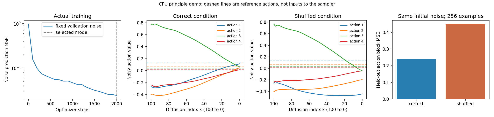

# 第五章——Diffusion Policy 如何生成动作

第三章学习从示范中直接预测动作，第四章把输出组织成动作块。本章保留动作块与滚动执行，学习另一种生成方式： **在观察条件下，逐步把随机噪声变成一段动作。** 

本章目标是分清训练与推理，能手算一次加噪和噪声预测损失，并运行一个小型条件去噪实验。

## 1. 具体问题：同一个观察，可能有不止一种合理动作

机器人绕过障碍物时，向左绕和向右绕都可能是合理示范。若一个确定性模型只输出一组动作，并用第三章的 MSE 拟合两种不同示范，它可能学到两者的平均；平均路线却可能正好经过障碍物。

用一个数简化这个问题：同样的观察下，示范动作分别为 -1 和 1，平均值为 0。0 不一定是两种操作中的任何一种。

我们希望模型能根据观察生成一种合理方案，而不是只能输出平均值。 **Diffusion Policy（扩散策略）** 把策略表示为条件去噪生成过程，用于生成动作序列。它仍从专家示范学习，属于模仿学习；生成模型也可以用于行为克隆，并不因使用扩散就自动变成强化学习。[原论文](https://arxiv.org/abs/2303.04137)

这个例子只说明单一输出加 MSE 的局限，不表示行为克隆一定失败，也不保证扩散生成的一切动作都正确。本章小 Demo 的人工专家每个观察只对应一个动作块， **不用于验证多种方案的生成能力** 。

## 2. 直观解释：先得到一张杂乱的路线单，再逐步整理

第四章让策略一次写出路线单。本章可以想成：先得到一张数字很乱的路线单，再根据“机器人在哪里、目标在哪里”反复修改，最后形成可执行的一段动作。

准确地说，“乱”是动作数值中的 **噪声（noise）** ，网络学习预测噪声，采样器依据预测更新动作块。噪声通常采用 **标准高斯分布（standard Gaussian distribution）** ：均值为 0、方差为 1，正负值都可能出现。

这里加噪的是模型内部的数值动作表示，不是给机器人施加物理推力。中间的噪声动作块也不直接发给控制器；生成完成后才执行选定的动作。动作的坐标系、单位、绝对位置或位移含义，以及归一化规则，仍遵守第二章。

## 3. 概念定义：分清环境时间与扩散噪声等级

| 符号或名词 | 中文、英文及用途 |
| --- | --- |
| $t$ | 环境时间步：机器人什么时候执行动作 |
| $k$ 、 $K$ | 扩散噪声等级与最高等级： $k=0$ 表示干净动作， $k=K$ 表示接近纯噪声 |
| $A_t^{(0)}$ | 当前环境时间 $t$ 对应的干净动作块，单个样本形状 `(H, d_a)` |
| $A_t^{(k)}$ | 同一动作块的第 $k$ 级加噪版本，形状不变 |
| $c_t$ | 条件（conditioning）：生成动作所依据的观察、目标等输入 |
| $\epsilon$ 、 $\hat\epsilon$ | 加入的真实噪声、网络预测的噪声，形状与动作块相同 |
| 调度器／采样器 | scheduler／sampler：规定噪声程度和去噪更新方法 |

继续使用第四章的 $H$ （预测动作步数）、 $E$ （重新预测前执行的动作步数）、 $d_a$ （每步动作维度）和 $B$ （批量大小）。批量动作与噪声张量均为 `(B, H, d_a)`；每个训练样本可抽取不同的 $k$ ，因此噪声等级张量形状为 `(B,)`。

例如一次生成 4 个动作，内部去噪 100 次，再执行前 2 个动作： $H=4$ 、 $E=2$ 、 $K=100$ 。 **100 次内部计算期间，环境时间 $t$ 不会因此前进 100 步。** 同一次生成通常固定观察条件；执行一段动作、获得新观察后，再开始下一次生成。

## 4. 数学与数值例子：训练时怎样加噪

先从示范取干净动作块 $A_t^{(0)}$ 。真实机器人数据通常先按确定规则归一化，再加噪。定义噪声日程：

$$
\alpha_k=1-\beta_k,\qquad
\bar\alpha_k=\prod_{r=1}^{k}\alpha_r,\qquad
\bar\alpha_0=1.
$$

 $\beta_k\in(0,1)$ 是第 $k$ 级的噪声方差系数， $\alpha_k$ 是信号保留系数， $\bar\alpha_k$ 是累积乘积； $r$ 只是乘积的编号。这些都是标量，随噪声等级变化，不是模型学习的参数。

可以直接从干净块计算任意一级的加噪块：

$$
A_t^{(k)}
=\sqrt{\bar\alpha_k}\cdot A_t^{(0)}
+\sqrt{1-\bar\alpha_k}\cdot\epsilon,
\qquad \epsilon\sim\mathcal N(0,I).
$$

 $\mathcal N(0,I)$ 表示展平动作块后，各分量独立服从标准高斯分布， $I$ 是对应维度的单位矩阵。两个平方根系数分别缩放干净信号与噪声。随着 $k$ 增大， $\bar\alpha_k$ 通常下降，信号成分减少、噪声成分增加。训练时不必先模拟前 $k-1$ 次加噪。[DDPM 原论文](https://arxiv.org/abs/2006.11239)

### 能手算的加噪例子

暂取 $H=2$ 、 $d_a=1$ ，用列向量表示两步动作：

$$
A^{(0)}=[1,0.5]^{\mathsf T},\qquad
\epsilon=[0.5,-1]^{\mathsf T},\qquad
\bar\alpha_k=0.64.
$$

为方便书写，省略环境下标 $t$ 。两个平方根系数是 0.8 和 0.6，因此：

$$
A^{(k)}
=0.8[1,0.5]^{\mathsf T}+0.6[0.5,-1]^{\mathsf T}
=[1.1,-0.2]^{\mathsf T}.
$$

三者形状都是 `(2, 1)`。第一项变成 1.1，超过原动作上限也正常： **噪声动作是内部变量，不是当前应执行的物理动作。** 

## 5. 训练：网络预测什么，损失比较什么

选择本章使用的 **噪声预测（noise prediction）** 方式，网络输出：

$$
\hat\epsilon=\epsilon_\theta(A_t^{(k)},k,c_t).
$$

 $\epsilon_\theta$ 是参数为 $\theta$ 的噪声预测网络，不是随机噪声本身。它读取噪声动作块、噪声等级和观察条件，输出与动作块同形状的噪声估计。条件告诉模型应该生成什么任务的动作；噪声等级告诉模型当前有多“乱”。

本章小批量损失沿用第三章的均方误差：

$$
L_{\text{noise}}=
\frac{1}{B H d_a}
\sum_{i=1}^{B}\sum_{h=0}^{H-1}\sum_{j=1}^{d_a}
(\hat\epsilon_{ihj}-\epsilon_{ihj})^2.
$$

 $i$ 是样本编号， $h$ 是动作块中的时间位置， $j$ 是动作分量编号。 $L_{\text{noise}}$ 是标量； $\hat\epsilon$ 与 $\epsilon$ 都是 `(B, H, d_a)`。本章所有窗口完整，没有补齐位置；若有补齐，须像第四章一样处理有效掩码。

 **比较的是预测噪声与本次真实加入的噪声，不是直接比较预测动作与专家动作。** 它们训练目标不同，不能把两种 MSE 的数值直接当作策略好坏的横向比较。

继续第 4 节的两分量例子，真实噪声为 `[0.5, -1]`，若网络预测为 `[0.3, -0.8]`，则：

$$
L_{\text{noise}}
=\frac{(0.3-0.5)^2+(-0.8-(-1))^2}{2}
=0.04.
$$

训练流程是“示范块 → 抽噪声等级与噪声 → 加噪 → 预测噪声 → MSE → 梯度更新”。一次参数更新通常只处理随机抽取的噪声等级，不必每次都完整去噪 100 次。核心代码对应为：

```python
# 本章一维动作内部省略最后的单例维：(B, H, 1) -> (B, H)
ab = alpha_bar[k][:, None]                # (B, 1)，广播到每步动作
noisy = ab.sqrt() * clean + (1 - ab).sqrt() * noise
pred_noise = model(noisy, condition, k)   # (B, H)
loss = ((pred_noise - noise) ** 2).mean() # 标量
loss.backward()
optimizer.step()
```

这里 `clean`、`noisy`、`noise` 都为 `(B, H)`，仅因 $d_a=1$ 而省略最后一维；含义仍与第四章一致。完整脚本会在每次更新前清空梯度。

## 6. 推理：从随机噪声生成动作，再进入闭环

推理时没有未来专家动作，也不知道“真实应该去掉的噪声”。先抽一个与动作块同形状的高斯噪声作为 $A_t^{(K)}$ ，再重复“预测噪声 → 采样器更新”，直到得到干净动作估计。网络参数固定，不进行梯度更新。

一个关键中间量是干净动作块的估计：

$$
\hat A_t^{(0)}=
\frac{A_t^{(k)}-\sqrt{1-\bar\alpha_k}\cdot\hat\epsilon}
{\sqrt{\bar\alpha_k}}.
$$

分子先扣除估计的噪声成分，再除以信号缩放系数。这个式子能估计干净块， **不是完整 DDPM 一步反向采样，也不能替代全部去噪过程** ；真正更新还要遵循所选采样器的规则。

在前面的手算例子中，使用预测噪声 `[0.3, -0.8]`：

$$
\hat A^{(0)}=
\frac{[1.1,-0.2]^{\mathsf T}-0.6[0.3,-0.8]^{\mathsf T}}{0.8}
=[1.15,0.35]^{\mathsf T}.
$$

它与专家 `[1, 0.5]` 不同，说明噪声预测误差会影响动作估计。本章采样时将干净动作估计限制到合法范围 $[-1,1]$ ，于是这个例子变成 `[1, 0.35]`；不会把每一级中间噪声块都强行裁剪到该范围。

生成完成后，恢复所需的动作单位与表示，再执行当前动作段，获取新观察，重新生成动作块。第三章的分布偏移和第四章的 $H/E$ 取舍仍然存在；扩散不保证消除失败，也不保证每一步去噪误差都单调下降。

### 选修：本章 Demo 的 DDIM 更新为什么不是“直接减去噪声”

 **DDPM（Denoising Diffusion Probabilistic Models，去噪扩散概率模型）** 与 **DDIM（Denoising Diffusion Implicit Models，去噪扩散隐式模型）** 使用不同的采样更新。本章采用 DDIM 的确定性形式： $\eta=0$ ，表示更新中不再额外抽取随机噪声；初始动作块仍从随机噪声开始。[DDIM 原论文](https://arxiv.org/abs/2010.02502)

令 $k'\lt k$ 是下一次、更低的噪声等级， $\tilde A_t^{(0)}$ 是按动作范围裁剪后的干净块估计，则本章更新为：

$$
A_t^{(k')}=
\sqrt{\bar\alpha_{k'}}\cdot\tilde A_t^{(0)}
+\sqrt{1-\bar\alpha_{k'}}\cdot\hat\epsilon.
$$

两个系数与下一噪声等级对应。最终 $k'=0$ 时， $\bar\alpha_0=1$ ，更新只剩干净块估计。Demo 从 $K$ 到 1 逐级更新，每级调用一次网络；代码使用长度 $K+1$ 的 `alpha_bar`，索引 0 保存无噪声时的系数 `alpha_bar[0]=1`，因此数学与代码都直接用 $k=1,\ldots,K$ 。本实现裁剪干净块估计后，继续使用原预测噪声，没有重新计算噪声。

```python
estimated_clean = (sample - (1 - ab).sqrt() * pred_noise) / ab.sqrt()
estimated_clean = estimated_clean.clamp(-1, 1)
sample = prev_ab.sqrt() * estimated_clean + (1 - prev_ab).sqrt() * pred_noise
```

`ab`、`prev_ab` 分别是当前与下一等级的累积系数；`sample` 是内部动作块。改变采样器、去噪次数或裁剪方式，都应重新核对公式与实验，不能把本段当作所有扩散模型通用的一行更新。

## 7. 代码 Demo：训练一个条件噪声预测网络

> **Demo 类型：小模型训练与生成原理实验。** 没有视觉编码器，没有实体机器人；它不等于官方 Diffusion Policy，也不是 PushT 仿真。

完整代码：[demo/chapter05_diffusion.py](demo/chapter05_diffusion.py)。继续使用一维人工专家：每一步位移为 `clip(0.5 * (goal - x), -1, 1)`，预测窗口长 $H=4$ 。当前位置与目标来自 $[-2,2]$ ，条件为 $c=[x/2,g/2]$ ，形状 `(2,)`，沿用第三章的输入缩放。

每个初始条件生成一个完整 4 步专家块。训练、验证和测试使用分开的初始条件；没有把同一轨迹的相邻窗口随机拆到不同集合。网络是 **多层感知机（Multilayer Perceptron，MLP）** ，使用噪声动作、条件和噪声等级预测噪声；这个小网络用于观察学习过程，正式视觉策略通常使用更强的结构。

具体形状是：4 个噪声动作数值、2 个观察条件数值，再加 16 个标识噪声等级的正弦／余弦特征，拼成 `(B, 22)`；经过 `22 → 128 → 128 → 4` 的网络，输出 `(B, 4)` 噪声估计。代码的 `time_embedding` 编码的是扩散等级 $k$ ，不是环境时间 $t$ 。

脚本固定 $K=100$ ，使用余弦噪声日程，按第 4 节的乘积计算 `alpha_bar`，末端系数约为 $2.43\times10^{-7}$ ，信号已经很弱，适合从近似纯高斯噪声开始生成。本章不要求推导余弦日程；它是已固定的噪声配置，不能仅凭名字认定与官方模型全部参数一致。

在章节目录运行：

```bash
python3 demo/chapter05_diffusion.py
```

已验证环境为 Python 3.11.9、PyTorch 2.12.1、NumPy 2.3.1、Matplotlib 3.10.3，使用 CPU。缺少依赖时，可在第三章的虚拟环境中安装：

```bash
python -m pip install numpy==2.3.1 torch==2.12.1 matplotlib==3.10.3
```

生成结果写入 `results/chapter05/`，保存指标、损失记录、网络参数和图表。本章对照实验只改变一个因素：把正确观察条件替换成打乱顺序的条件，保持同一个已训练模型、测试目标和初始噪声不变。若生成动作变差，说明模型在这组测试中用到了观察条件；它不是机器人任务成功率的测量。

需要另存复习运行结果时，可使用脚本支持的输出参数：

```bash
python3 demo/chapter05_diffusion.py --output results/chapter05_repeat
```

## 8. 结果解读：分别看噪声损失与生成动作误差

本次实际训练使用 4,096 个训练初始条件、1,024 个验证条件、256 个最终测试条件，数据种子分别为 7、8、1009。批量为 256，使用 **Adam（Adaptive Moment Estimation，自适应矩估计）优化器** ，它利用历史梯度调整参数更新尺度；学习率 0.001，更新 2,000 次。按固定验证噪声的 MSE 选中第 2,000 步模型。推理初始噪声种子为 207，两组对照复用同一噪声。

结果来源：[metrics.json](results/chapter05/metrics.json)。本机此次训练循环约 1.43 秒，包含周期性验证，不含 Python 启动、最终采样与绘图；其他机器耗时可能不同。

| 指标 | 实际结果 |
| --- | ---: |
| 网络参数量 | 19,972 |
| 初始验证噪声 MSE | 0.981934 |
| 选中模型的验证噪声 MSE | 0.023969 |
| 正确观察条件：256 个测试动作块的 MSE | 0.239619 |
| 打乱观察条件：同一批测试动作块的 MSE | 0.450073 |

后两行用生成后的干净动作块与专家块比较，按全部 `256 × 4` 个位移分量取均方误差。前两行比较的是噪声，因此不能拿 `0.023969` 与 `0.239619` 直接判断哪个阶段“更成功”。



从左到右看图：验证噪声损失下降；固定测试首样本在正确条件下生成一段动作；同一初始噪声在打乱条件下产生不同结果；最后汇总 256 个测试样本的动作误差。中间两图横轴是 $k$ ，从 100 走到 0，每条曲线是动作块中一个时间位置的数值。虚线是事后画出的专家参考，不是采样器输入，也不是已经执行的机器人轨迹。

打乱条件后的平均误差更大，说明模型使用了观察条件。但正确条件下的生成质量仍有限，不能只看首样本就认定可靠。真实测试中，最差样本为 $x\approx-1.974555$ 、 $g\approx1.800056$ ：

```text
专家动作块：[1, 1, 0.887305, 0.443653]
生成动作块：[-1, -1, -1, -1]
动作块 MSE：3.411514
```

目标在当前位置右侧，生成块却全部向左，动作方向错误。这里没有实际执行该块或评测闭环成功率；它已经足以说明： **低噪声损失不保证每个生成动作正确，合法范围内的动作也可能完全不适合任务。** 这个小实验展示了训练与采样流程，不能代表完整 Diffusion Policy 的性能。

开发期间曾比较两种日程和两种训练长度，使用的探索样本没有继续充当最终测试；固定本章配置后，再用未查看过的种子 1009 测试。[开发记录](results/chapter05/development_trials.json)与[损失记录](results/chapter05/loss_history.json)保留真实过程，后续实验不要根据最终测试结果反复挑参数。

## 9. 连接官方 Diffusion Policy：小模型与真实策略有什么对应关系

扩散模型的经典基础包括 DDPM 与 DDIM；Diffusion Policy 是将条件动作生成、视觉输入和滚动执行结合起来的代表性机器人学习方法。本章理解它的基础流程，后续贯穿项目优先尝试预训练 PushT 策略，不在两周内从头训练大型视觉模型。[作者项目页](https://diffusion-policy.cs.columbia.edu/)

截至 2026-10-02，已核对作者项目、LeRobot 实现和公开模型配置：原论文仓库可用，最近主分支提交为 2024-12-24，适合追溯研究实现；LeRobot 持续提供扩散策略代码与版本发布。[原仓库](https://github.com/real-stanford/diffusion_policy)、[LeRobot 固定源码](https://github.com/huggingface/lerobot/blob/e0d50211ef236143ae867228662b7dfaba554f02/src/lerobot/policies/diffusion/modeling_diffusion.py)

公开模型 [lerobot/diffusion_pusht](https://huggingface.co/lerobot/diffusion_pusht) 的权重文件约 1.05 GB。以下数值来自 **这份预训练权重** ，不是所有 Diffusion Policy 或当前库的默认配置：[固定配置](https://huggingface.co/lerobot/diffusion_pusht/blob/84a7c23178445c6bbf7e1a884ff497017910f653/config.json)

| 项目 | 官方预训练 PushT 模型 | 本章小 Demo |
| --- | --- | --- |
| 条件输入 | 两帧图像，各 `(3, 96, 96)`，及各 `(2,)` 推杆位置 | 当前 $x$ 、 $g$ ，共两个数 |
| 每步动作 | 二维推杆绝对目标坐标 | 一维位移，范围 $[-1,1]$ |
| 动作窗口／执行段 | 窗口 16 步，执行当前开始的 8 步 | 窗口 4 步，本章只评测生成块 |
| 扩散噪声等级 | 100，预测噪声 | 100，预测噪声 |
| 采样方式 | 该配置为 DDPM，默认去噪 100 次 | DDIM，去噪 100 次 |
| 本章实际运行情况 | 只核对模型卡、配置和上游代码 | 训练小 MLP 并生成动作块 |

这份视觉模型的 `(2,)` 状态只含推杆位置，方块信息来自图像，与第三章教学用的完整五维状态观察并不矛盾。它对动作／状态做 MIN_MAX 归一化，对图像做 MEAN_STD 标准化；接环境前还需要配套的预处理和反归一化，不能直接拿内部噪声数值当 PushT 坐标。

正式实现先由视觉编码器提取图像特征，再用 **条件一维 U-Net（Conditional 1D U-Net）** 预测动作噪声。U-Net 是一种先压缩、再恢复特征的 U 形网络结构，此处沿动作时间轴处理序列。扩散描述的是训练与采样方法，不限定必须采用 U-Net；作者也提供 Transformer 实现，本章则用小 MLP 讲同一类噪声预测流程。[官方模型源码](https://github.com/huggingface/lerobot/blob/e0d50211ef236143ae867228662b7dfaba554f02/src/lerobot/policies/diffusion/modeling_diffusion.py)

### 观察历史会影响动作时间对齐

第四章与本章小 Demo 的动作块第 0 行对应当前动作。上述官方模型用两帧观察，动作窗口从 $t-1$ 开始，所以当前动作位于窗口索引 1；执行索引 1～8，才对应环境时间 $t$ 到 $t+7$ 。代码是：

```python
start = n_obs_steps - 1                  # 2 - 1 = 1
actions = all_actions[:, start:start + n_action_steps]  # [:, 1:9]
```

`n_obs_steps` 是观察帧数，`n_action_steps` 是执行段步数。这个对齐约定不会改变动作的物理含义，却会改变执行切片。读官方代码时，要检查“每行对应哪个环境时间”，不能机械地取最前八行。

官方代码把第 4 节的加噪交给 `scheduler.add_noise`，把推理更新交给 `scheduler.step(...).prev_sample`；观察编码、噪声预测网络、采样器与动作执行是不同职责。[原策略代码](https://github.com/real-stanford/diffusion_policy/blob/5ba07ac6661db573af695b419a7947ecb704690f/diffusion_policy/policy/diffusion_unet_image_policy.py)

### 软件、硬件与运行成本

本章使用本机 CPU 完成小模型实验，无需租用 GPU。完整官方模型另配隔离环境：LeRobot v0.6.1 要求 Python ≥3.12、PyTorch ≥2.7 且 <2.12，扩散额外依赖 Diffusers ≥0.38 且 <0.40，与本章 Python 3.11／PyTorch 2.12 环境不同。[版本依赖](https://github.com/huggingface/lerobot/blob/v0.6.1/pyproject.toml)

模型卡注明这份权重由较旧 LeRobot 版本训练，文件能访问不代表已验证与新版兼容。本章未下载权重、未计时官方推理，也未运行模型卡旧命令；完整 PushT 环境与推理命令将在实际兼容测试后记录。

若以后从头训练视觉扩散策略，官方硬件指南对其特定示例粗估约需 8～14 GB 显存、3090／4090 级 GPU 上数小时。这不是本机实测，也不是任意任务的保证；两周入门路线优先预训练推理，小模型负责训练原理实验。[官方硬件指南](https://huggingface.co/docs/lerobot/main/en/hardware_guide)

## 10. 小练习（全章共 3 题）

三题分别对应第 4 节加噪、第 5 节噪声损失、第 3、6 节的两个时间轴。只改正文中的数值，不增加新公式。

1. 某一步的干净动作是 0.5，加入的噪声是 -0.5， $\bar\alpha_k=0.64$ 。加噪后的数值是多少？提示：两个系数仍为 0.8 和 0.6。
2. 真实噪声为 `[0.2, -0.4]`，网络预测为 `[0.4, -0.3]`。这两个分量的噪声预测 MSE 是多少？结果是两个数还是一个标量？
3. 一次生成 $H=4$ 个动作，内部去噪 10 次，执行时域 $E=2$ 。机器人在一次生成期间已经执行了 10 个动作吗？生成结束后先执行几个动作，再根据新观察生成下一块？

### 参考答案（先独立作答，再对照）

1. $0.8\times0.5+0.6\times(-0.5)=0.1$ 。噪声数值可以是负数，加噪不一定使某一分量变大。
2. $((0.4-0.2)^2+(-0.3-(-0.4))^2)/2=(0.04+0.01)/2=0.025$ ，是一个标量，比较的是噪声而非动作标签。
3. 没有。10 次是生成器内部计算，不是机器人动作执行。生成 4 步后先执行 2 步，获取新观察再生成。

## 11. 来源与许可

- [Diffusion Policy 原论文](https://arxiv.org/abs/2303.04137)与[作者项目页](https://diffusion-policy.cs.columbia.edu/)：条件动作扩散与滚动执行，RSS 2023／IJRR 2024。
- [DDPM 原论文](https://arxiv.org/abs/2006.11239)：前向加噪与噪声预测目标；[DDIM 原论文](https://arxiv.org/abs/2010.02502)：本章采样更新的依据。
- [原始 Diffusion Policy 代码](https://github.com/real-stanford/diffusion_policy)：MIT 许可证；[LeRobot](https://github.com/huggingface/lerobot)：Apache-2.0 许可证。
- [官方预训练模型与模型卡](https://huggingface.co/lerobot/diffusion_pusht)：公开权重、配置与原训练版本记录，模型卡标注 Apache-2.0 许可证；本章只核对资料，没有下载或重新分发权重。

本章 Demo 和图表由本教程编写、实际运行生成，没有复制完整上游策略或官方实验结果。下一章学习 VLA 如何把视觉、语言与动作连接起来；无论采用哪种生成方式，最终都要进入第一章的观察、动作与反馈闭环。
