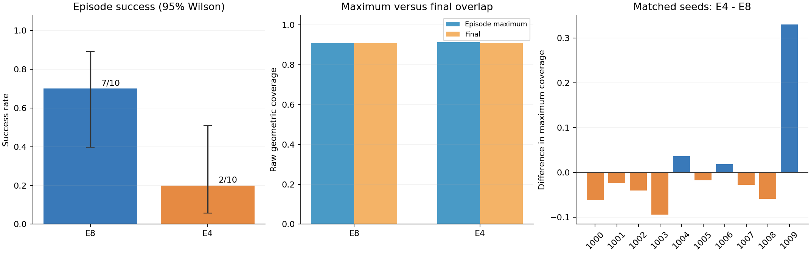
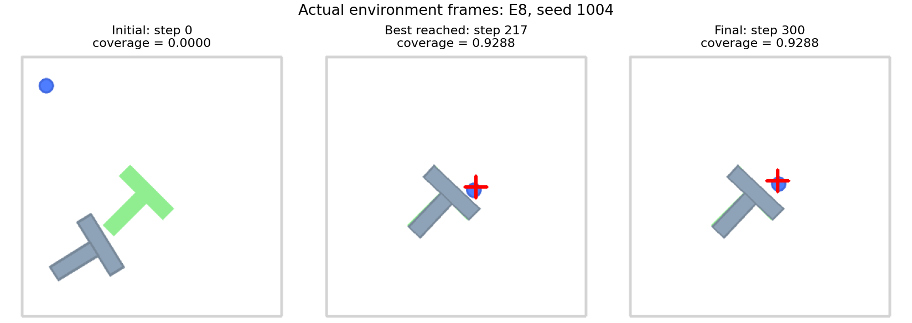
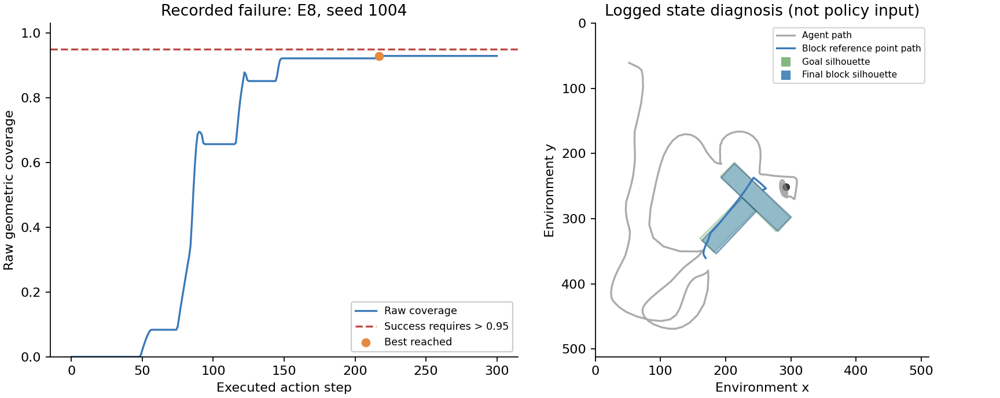

# 第八章——判断机器人到底学会了什么

第七章已经把模型、观察、动作与物理环境连接起来。本章使用同一批实际回合，学习怎样评价结果：任务是否完成、成功率由多少次实验支持、换条件以后怎样变化，以及一次失败能告诉我们什么。

本章的完成标准是能读懂结果表、解释至少一个失败回合，并用安装命令、配置、模型版本与日志复现分析。运行出一段顺畅的视频，是评测的起点。

## 1. 具体问题：一段成功视频，能说明模型已经学会了吗

假设只展示一个成功回合，我们仍不知道：它一共尝试了多少次，失败回合是否被隐藏，初始位置是否反复挑选，换一台机器人或换一个相机后还能不能成功。

先明确要支持的结论，再选择对应实验。第七章的主问题是：“固定这个预训练策略、环境与初始种子，只改变重新预测前执行的步数，会观察到什么差别？”它没有测试重新训练的效果，也没有验证实体机器人安全。

## 2. 直观解释：既看成绩单，也看错题本

成功率像成绩单，逐回合视频和轨迹像错题本。成绩单概括整体表现，错题本帮助我们看到具体行为；两者合起来才便于解释结果。

准确地说，先保存每个回合的原始记录，再按预定指标汇总，保留成功与失败。失败图可以显示物体偏离目标、接触方向或覆盖率变化，但只凭一张图，通常不能唯一确定模型内部为什么这样预测。

打开[交互学习页](interactive/index.html)中的“评测”：切换条件，查看每个回合，调整成功阈值或可见步数预算，观察统计如何改变。GitHub 文件浏览页显示 HTML 源码，下载后用浏览器打开，或使用 [README 的本地启动方法](README.md#交互学习)。这些操作用于理解指标；教程报告的正式结果仍使用第七章预先固定的阈值与预算。

## 3. 概念定义：成功、泛化、数据泄漏与失败

| 名词 | 中文、英文及用途 |
| --- | --- |
| 指标 | metric：把某种表现转换为可比较的数值 |
| 成功率 | success rate：完成任务的回合占总评测回合的比例 |
| 泛化 | generalization：在未用于拟合、选择模型的条件下，仍能完成任务 |
| 分布偏移 | distribution shift：部署输入与学习时的数据条件不同 |
| 数据泄漏 | data leakage：训练或选择模型时，使用了本应独立留作评测的信息 |
| 对照实验 | controlled experiment：固定其他条件，只改变一个明确因素 |

“未见过”需要说明是哪种变化：新回合、新位置、新物体、新相机、新机器人分别是不同难度的测试。仅改变随机种子，不能自动证明跨场景或跨机器人泛化。

本章的预训练模型训练数据来自上游。我们固定的仿真种子没有根据本次结果挑选，但没有穷尽检查所有初始状态是否与上游训练样本相似。因此结果支持这组固定评测条件下的表现，不能直接称为严格排除训练重合的泛化测试。

## 4. 数学与手算：从回合记录得到指标

### 4.1 成功率的分母必须写清楚

设评测 $N$ 个回合，第 $i$ 个回合的成功标记为 $s_i$ ：

$$
s_i=\begin{cases}1,&\text{回合成功},\\0,&\text{回合失败},\end{cases}
\qquad S=\sum_{i=1}^{N}s_i,
\qquad \hat p=\frac{S}{N}.
$$

 $N$ 是总回合数， $i$ 是回合编号， $S$ 是成功回合数， $\hat p$ 是本次样本成功率；三者中的 $N$ 与 $S$ 为整数， $\hat p$ 为标量。所有回合的成功标记可组织为形状 `(N,)` 的数组。

比如 10 个回合成功 6 个，成功率就是 `6 / 10 = 0.6 = 60%`。这是 10 次尝试的结果，不能因为数值相同，就把它当作 1,000 次评测也成功 60% 的证据强度。

对应代码：

```python
successes = sum(episode["success"] for episode in episodes)
success_rate = successes / len(episodes)
```

第七章已经核对：环境成功条件是原始覆盖率严格大于 0.95。这里直接读取保存的成功布尔标记，不用奖励值猜测是否完成任务。

### 4.2 最大覆盖率与最终覆盖率回答不同问题

沿用第七章原始覆盖率 $c_{it}$ ， $i$ 表示回合， $t$ 表示该回合的环境步， $T_i$ 是实际结束步：

$$
c_i^{\max}=\max_{0\le t\le T_i}c_{it},
\qquad c_i^{\text{final}}=c_{iT_i},
\qquad \bar c^{\max}=\frac1N\sum_{i=1}^{N}c_i^{\max}.
$$

 $c_i^{\max}$ 表示曾经最好到达哪里， $c_i^{\text{final}}$ 表示结束时停在哪里， $\bar c^{\max}$ 是所有回合最大覆盖率的平均，均为标量。各回合长度不同，所以完整轨迹是一组长度不一的列表，不能未经补齐就假设它是固定矩形张量。

手算一个失败回合的覆盖率序列 `[0.20, 0.90, 0.70]`：最大值为 0.90，最终值为 0.70，两者都未越过 0.95。只报告最大值，会忽略“接近目标后又偏离”的现象；只报告最终值，会看不到它曾经接近过目标。

两个回合的最大覆盖率若为 0.9、0.7，平均最大覆盖率为 `(0.9 + 0.7) / 2 = 0.8`。它不表示有 80% 的回合成功；成功率与覆盖率是不同指标。

### 4.3 同一个初始种子怎样做配对比较

在相同回合种子下，记两组设置的最大覆盖率为 $c_{i,8}^{\max}$ 与 $c_{i,4}^{\max}$ ，下标 8、4 表示执行时域：

$$
d_i=c_{i,4}^{\max}-c_{i,8}^{\max},
\qquad \bar d=\frac1N\sum_{i=1}^{N}d_i.
$$

 $d_i$ 是第 $i$ 对回合的差， $\bar d$ 是平均差，均为标量。所有配对差组成形状 `(N,)` 的数组；方向固定为“执行 4 步组减执行 8 步组”。

例如同一初始种子下，两组分别达到 0.80 与 0.90，则差为 `0.90 - 0.80 = +0.10`，表示这一对中执行 4 步组最大覆盖率更高。若换成不同种子再比较，就可能把初始状态难度混进设置差异。

配对控制初始条件，不会使后续轨迹保持一致。执行时域改变后，重新观察与生成动作的时刻改变，策略输出与接触反馈也会不同。小样本平均差主要帮助理解这组实验，不能据此宣称某个时域在所有任务上更好。

### 选修：为什么成功率最好带一个区间

成功率是样本比例。若把回合视为来自同一分布、相互独立的成功／失败试验，可以用 **Wilson 区间（Wilson score interval）** 展示抽样不确定性的量级。

令 $z=1.96$ 是约 95% 区间采用的系数，定义分母 $D$ 、区间中心 $m$ 与半宽 $h$ ：

$$
D=1+\frac{z^2}{N},\qquad
m=\frac{\hat p+z^2/(2N)}{D},\qquad
h=\frac{z\sqrt{\hat p(1-\hat p)/N+z^2/(4N^2)}}{D}.
$$

区间为 $[m-h,m+h]$ ，所有符号均为标量。对 6/10，代入得到约 `[0.313, 0.832]`，比单独写 60% 更能提示样本量有限。完整计算见代码中的 `wilson_interval`；本章不要求手推该式。

这一区间依赖抽样假设，不是所有新场景的保证，也不是两组时域差异的显著性检验。固定少量种子便于复现；要支持更广的结论，仍需要更大且有代表性的评测设计。[NIST 比例区间说明](https://www.itl.nist.gov/div898/handbook/prc/section2/prc241.htm)

## 5. 代码 Demo：重新分析第七章真实日志

完整代码：[demo/chapter08_evaluate.py](demo/chapter08_evaluate.py)。运行后会核对逐回合记录、计算指标与配对差，生成结果表和失败图：

```bash
python3 demo/chapter08_evaluate.py
```

如果已激活第七章虚拟环境，也可以直接在该环境运行；分析只使用 JSON、NumPy 与 Matplotlib，不会加载 1 GB 模型或重新进行策略推理。

分析自己的复现实验时：

```bash
python3 demo/chapter08_evaluate.py \
  --input results/chapter07_repeat/evaluation.json \
  --output results/chapter08_repeat
```

脚本会检查重复回合、覆盖率范围、两组种子是否配对等条件。读者可以先查看附带的真实日志进行学习，再独立运行第七章产生自己的日志；两者的验证范围分别记录。

## 6. 结果解读：成绩单与一个失败回合

本次每组评测 10 个回合，共 20 个回合；分别使用每组的 10 作为成功率分母，不把两组相加后的 20 用作每组分母。

| 条件 | 成功 / 总数 | 成功率 | 95% Wilson 区间（选修） | 平均最大覆盖率 | 平均最终覆盖率 |
| --- | ---: | ---: | --- | ---: | ---: |
| E8 | 7 / 10 | 70% | [39.7%, 89.2%] | 0.907874 | 0.907585 |
| E4 | 2 / 10 | 20% | [5.7%, 51.0%] | 0.913802 | 0.910880 |

结果来自 [metrics.json](results/chapter08/metrics.json)和自动生成的 [RESULTS.md](results/chapter08/RESULTS.md)。分析实际核对了 20 回合逐步动作、奖励、终止标记、覆盖率和汇总的一致性；10 对初始状态及前四步动作、状态的最大绝对差均为 0。



从左到右看图：成功率及选修区间；两种覆盖率的平均；每个相同种子的最大覆盖率差，方向为 E4 减 E8。区间体现有限样本下的不确定性，不作为两种设置差异的显著性检验。

### 6.1 为什么平均覆盖率更高，成功率却更低

E4 的平均最大覆盖率比 E8 高约 0.00593，但成功率从 70% 降到 20%。这并不矛盾：成功率数的是越过固定门槛的回合，平均覆盖率还会受未越过门槛的回合影响。

本次 seed 1009 的 E4 最大覆盖率比 E8 高约 0.330179，明显拉高平均差；然而两组在这个种子上都失败。另有 7 个种子只有 E8 成功，2 个只有 E4 成功，没有两组都成功的种子。因此不能说 E4 在每个起点都更差，也不能因为平均覆盖率提高，就说它完成任务的能力已经提高。

这些是本次固定对照中观察到的事实。我们没有重新训练模型、扩大测试种子或改变动力学，不能把结论推广成“所有机器人都应执行 8 步”。

### 6.2 错题本：看起来几乎重合，为何仍然失败

失败案例按“先 E8，再 E4；同组按种子递增”的规则选取，首个是 **E8／seed 1004** ：





日志显示第 217 步达到最高覆盖率约 0.928778，到第 300 步结束时仍为该值，未超过 0.95。画面中物体已经大部分覆盖目标，但还露出目标边缘；最后 20 个动作步的物体参考点位移为 0。

结束时，物体参考点与目标参考点相距约 1.19 个场景坐标单位，朝向误差约 -1.68°。位置看起来接近，仍可能因为轮廓与朝向的小误差而未达标。这里说的是记录的参考点，不把它自动当作几何中心。

这些证据说明该回合没有继续纠正剩余误差。可能原因还需检查生成动作、接触状态、视觉特征与示范分布；仅凭这段视频，不能唯一断言是训练数据不足、策略误判完成或扩散方法失效。

[逐步轨迹](results/chapter07/trajectories/E8_seed1004.json)、[完整视频](results/chapter07/videos/E8_seed1004.mp4)、[可直接查看的失败 GIF](results/chapter07/videos/representative_failure.gif)均保留，读者可以在交互页按步核对。

## 7. 泛化与数据泄漏：怎样让结论可信

第三章、第四章已经要求按完整轨迹划分数据。本章把这条原则扩展到整个实验过程：

- **训练集合** 用于更新参数；相邻窗口来自同一回合时，应留在同一集合。
- **验证集合** 用于选择检查点、采样设置或其他参数。
- **最终测试集合** 用于报告固定方案的表现；查看结果后反复改参数，应另设新的最终测试集合。

本次 E8/E4 是事先声明的对照，报告两组全部回合，不按结果删掉困难种子。未来如果据此选择 E4 作为默认设置，这批回合就已经参与了方案选择，需要在新种子上再次评测，才适合报告选择后的表现。

做泛化实验时，一次明确改变一种条件：例如初始位置范围、物体摩擦或相机视角。若同时换模型、相机、任务和随机种子，结果变化就难以解释。第七章的执行时域对照评价执行设置，不等于已经完成这些泛化实验。

网页中修改阈值会立即改变成功数量，因为 **评分规则变了** 。模型、轨迹与动作并没有因此改善。更改可见步数只是在原轨迹前缀上重算结果，不能冒充重新以该预算运行的独立实验；已经终止的回合也没有后续未记录动作。例如把阈值提高到 0.98，现有日志不能告诉我们：原本在超过 0.95 时终止的回合，如果继续执行，是否还会达到 0.98。

## 8. 从失败到安全边界：先描述，再验证原因

分析失败时，先写可观察的事实，例如“覆盖率在第 120 步后下降”“推杆从物体侧面绕开”“角度偏差一直没有消除”，再提出可能原因，并设计能区分这些原因的实验。

例如“反馈利用太晚”与“生成动作本身方向错误”是不同假设。可以分别比较执行时域、检查重新预测时的动作和实际接触状态；不能只因为一个回合失败，就断言扩散方法不行或训练数据一定太少。

仿真成功只说明这一仿真设置中的行为。迁移到真实机器人还涉及坐标标定、控制频率、执行延迟、接触模型差异与硬件限制。应在与设备匹配的控制接口和约束下重新验证；本教程没有通过实体机器人的安全验收。

## 9. 小练习（全章共 3 题）

1. 一共评测 20 个回合，成功 13 个。成功率是多少？能否只凭这个数判断比“2 个回合成功 2 个”的策略更差？
2. 一个回合记录的原始覆盖率为 `[0.30, 0.92, 0.85]`。最大覆盖率、最终覆盖率分别是多少？按原始阈值 0.95 是否成功？
3. 看过最终测试结果后，反复调执行时域并删除失败种子，最后只保留最好的设置与回合。这样的结果能否用来报告独立测试表现？应该怎样补救？

### 参考答案（先独立作答，再对照）

1. `13 / 20 = 0.65 = 65%`。不能只比较 65% 与 100% 就下结论；两者的样本量、初始条件与评测规则还要对齐，2 个回合的证据很有限。
2. 最大覆盖率为 0.92，最终覆盖率为 0.85。没有超过 0.95，未成功。它曾经更接近目标，但结束时偏离得更多。
3. 不能。这批数据已经参与参数选择，而且删除失败回合改变了评测集合。应保留原始完整结果，把它用于开发／验证，并在新的预先固定测试集合上报告选定方案。

## 10. 八章验收与来源

八章材料齐备后，学习者还需要亲自完成以下验收：

| 验收项 | 可检查的证据 |
| --- | --- |
| 解释核心流程 | 用自己的话说明状态、观察、策略、动作、反馈，以及目标与奖励的区别 |
| 解释数学与形状 | 手算坐标、限幅或损失，解释样本／时间／动作分量三个轴 |
| 区分主要方法 | 解释示范学习、动作分块、扩散生成、VLA 条件的关系，以及训练与推理的区别 |
| 运行完整任务 | 独立执行第七章一个回合，保存自己的命令与日志 |
| 分析失败 | 选一个失败回合，指出事实、可能原因和需要补充的验证 |
| 交付复现教程 | 八章正文、代码、配置、版本、来源与许可、真实结果及交互页都可访问 |

每项是否完成分别记录在 [PROGRESS.md](PROGRESS.md)。作者已经运行过 Demo、教程已经写好，都不能代替学习者的独立解释与复现。

数学区间引用 [NIST 比例置信区间说明](https://www.itl.nist.gov/div898/handbook/prc/section2/prc241.htm)。仿真、动作与覆盖率定义沿用第七章的固定版本，详见[第七章来源](第七章——跑通一个完整仿真任务.md#8-来源许可与复现边界)及 [gym-pusht 0.1.5](https://pypi.org/project/gym-pusht/0.1.5/)。分析脚本、结果图表和失败分镜为本教程实际生成的内容，不复制论文图片。上游模型、环境与示范数据的不同许可证仍分别保留。
