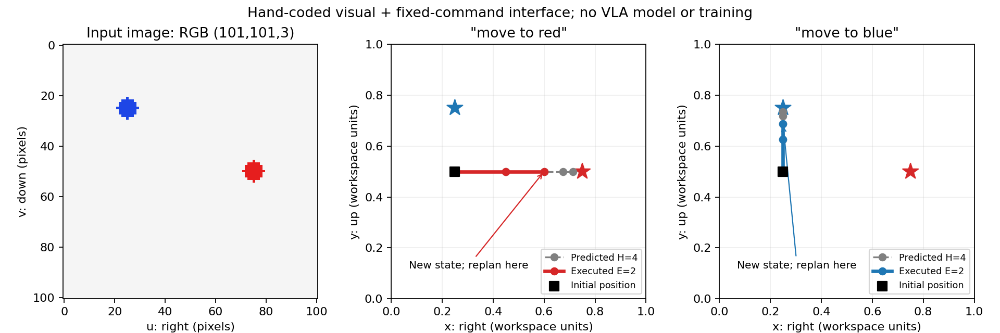

# 第六章——VLA 如何连接视觉、语言与动作

前五章已经连起了“观察 → 策略 → 动作 → 反馈”：第三章学习专家示范，第四章预测动作块，第五章通过条件生成得到动作。本章继续这条主线，加入图像与语言指令，理解 **VLA（Vision-Language-Action，视觉—语言—动作模型）** 怎样根据“看到了什么、要做什么、机器人当前处于什么状态”生成动作。

本章目标是读懂 VLA 的输入输出、区分训练与推理，并通过一个小 Demo 看清语言条件如何改变动作。学习后应能解释：同一张图像，为什么换一句指令就可能需要不同动作。

## 1. 具体问题：看见两个物体，机器人应该靠近哪一个

画面中有红色和蓝色两个目标，机器人当前位置相同。我们分别说：

- “移动到红色目标。”
- “移动到蓝色目标。”

图像告诉机器人目标在哪里，语言指定当前要操作哪个目标，自身的位置则影响应该怎样移动。只看图像，任务可能不明确；只看文字，又不知道目标的实际位置。

第一章把目标写成坐标 $g$ 。现在，人先用语言描述任务，策略需要结合视觉决定动作。 **语言是一种任务条件，不是奖励。** 奖励是评价行为或结果的数值；“移动到红色目标”这句话本身没有给出得分。

## 2. 直观解释：看现场、读任务、形成可执行计划

可以把 VLA 想成一个收到现场照片与任务说明的执行者：先结合二者理解当前任务，再形成一段动作计划。

准确地说，图像和文字经过编码成为数值特征，策略融合这些特征，动作输出模块据此产生控制量。很多 VLA 还读取关节位置等机器人自身状态。它不一定先生成一段解释文字，也不一定显式输出“物体坐标”这个中间结果。

**视觉语言模型（Vision-Language Model，VLM）** 通常连接图像和文字；VLA 进一步学习与机器人动作的对应关系。能描述“桌上有杯子”，不等于已经学会安全地抓起杯子；后者还涉及机器人结构、动作定义、示范数据与环境反馈。

```text
图像 + 语言指令 + 机器人自身状态
              ↓
        编码与信息融合
              ↓
        动作块生成与解码
              ↓
     恢复动作单位，执行前 E 步
              ↓
       新观察 → 再次预测
```

这是一种便于理解的功能划分，不要求所有 VLA 都有完全相同的模块。第四章的动作块和滚动执行、第二章的坐标系与动作单位，仍然适用。

## 3. 概念定义：输入是多种信息，输出仍是动作

**多模态（multimodal）** 指联合使用不同形式的信息，例如图像、文字与数值状态。**编码器（encoder）** 把原始输入转换为可供网络处理的特征；**动作头／动作专家（action head / action expert）** 根据这些特征生成动作，具体结构因模型而异。

把一次动作块预测简写为：

$$
\hat A_t=\pi_\theta(I_t,\ell,q_t),
\qquad \hat A_t\in\mathbb R^{H\times d_a}.
$$

- $t$ 是环境时间步； $I_t$ 是当前图像，这里先只考虑一个相机。
- $\ell$ 是语言指令； $q_t$ 是机器人自身的数值观察，例如关节位置或末端位置。它不是第一章中的完整环境状态。
- $\pi_\theta$ 是参数为 $\theta$ 的策略； $\hat A_t$ 是预测动作块，帽子表示预测。
- $H$ 是预测动作步数， $d_a$ 是每步动作维度，与第四章相同。上式省略生成模型内部的随机噪声，因此不表示所有 VLA 都是确定性映射。

以常见的批量接口为例， **RGB（Red、Green、Blue）** 表示红、绿、蓝三个颜色通道：

| 数据 | 典型形状 | 各轴含义 |
| --- | --- | --- |
| RGB 图像 | `(B, 3, H_img, W_img)` | 样本、颜色通道、像素高、像素宽 |
| 文字 token 编号 | `(B, L)` | 样本、补齐后的文字序列位置 |
| 文字有效掩码 | `(B, L)` | 标记真实文字与补齐位置 |
| 机器人自身状态 | `(B, d_q)` | 样本、自身状态分量 |
| 动作块 | `(B, H, d_a)` | 样本、未来动作步、动作分量 |

这里 $B$ 是批量大小， $L$ 是补齐后的文字长度， $d_q$ 是自身状态维度； $H_{\text{img}}$ 与 $W_{\text{img}}$ 表示像素高宽，不能把图像高度与预测时域 $H$ 混为一谈。

**Token（词元）** 是文字切分后送入模型的单元，可能是一个词、词的一部分或标点；token 编号只是词表索引，经过可学习的 **Embedding（嵌入）** 才变成特征向量。图像通常也会被编码为一组特征，二者通过网络交互。不同模型的相机数量、图像尺寸、历史帧数和状态维度不相同，不能照搬这张示意表当成具体模型的配置。

## 4. 数学与手算：语言怎样改变动作

先用可手算的规则拆开这个过程。 **本节的颜色检测与文字选择都是人为编写的，不是训练出的 VLA。** 正式模型通常学习特征与动作之间的关系，不必遵循这里的显式目标选择步骤。

### 4.1 从图像位置得到平面坐标

Demo 使用 `101 × 101` 的合成俯视图。图像像素坐标 $(u,v)$ 从左上角开始， $u$ 向右、 $v$ 向下；教学平面坐标 $(x,y)$ 则向右、向上，范围均为 $[0,1]$ ：

$$
x=\frac{u}{W_{\text{img}}-1},
\qquad y=1-\frac{v}{H_{\text{img}}-1}.
$$

像素编号从 0 开始，所以宽高为 101 时，最大编号为 100。比如红色目标的像素中心是 `(75, 50)`，对应平面位置 `(0.75, 0.5)`；蓝色中心 `(25, 25)` 对应 `(0.25, 0.75)`。

这只是合成图像与教学平面的一一对应。真实相机从像素到机器人坐标通常还需要相机标定、深度或平面假设，不能直接用这个比例式替代第二章的坐标变换。

### 4.2 用语言选择目标

把检测出的两个目标按“红、蓝”的顺序放进矩阵：

$$
V=\begin{bmatrix}0.75&0.50\\0.25&0.75\end{bmatrix},
\qquad
w_{\text{red}}=[1,0],\quad w_{\text{blue}}=[0,1],
\qquad g=wV.
$$

 $V$ 的形状是 `(2, 2)`，两行分别是两个目标、两列分别是平面坐标； $w$ 的形状是 `(2,)`， $g$ 是选出的目标坐标，形状也是 `(2,)`。这种只有一个分量为 1 的表示叫 **独热编码（one-hot encoding）** 。这里程序只识别 `move to red` 与 `move to blue` 两条固定指令。

例如蓝色指令得到：

$$
g=[0,1]V=0[0.75,0.50]+1[0.25,0.75]=[0.25,0.75].
$$

对应代码是 `goal = instruction_weights @ visual_positions`。这次矩阵乘法用于演示“文字参与决定目标”，不等于完整的注意力机制，也不等于大模型的语言理解能力。

### 4.3 从目标得到二维动作

沿用第一章的比例规则，并把位置扩展成二维：

$$
a=\operatorname{clip}\bigl(\lambda(g-p),-c,c\bigr),
\qquad p_{\text{next}}=p+a.
$$

 $p$ 是当前位置， $g$ 是目标， $a$ 是本步位移，三者形状均为 `(2,)`； $\lambda=0.5$ 是比例系数， $c=0.2$ 是每个坐标分量的位移上限，均为标量。`clip` 逐分量限幅，因此它约束的是每轴位移，而不是二维位移的总长度。

令 $p=[0.25,0.50]$ 。红色指令下：

$$
a_{\text{red}}
=\operatorname{clip}\bigl(0.5([0.75,0.50]-[0.25,0.50]),-0.2,0.2\bigr)
=[0.20,0].
$$

蓝色指令下，未限幅结果为 `[0, 0.125]`，在范围内，所以动作就是 `[0, 0.125]`。图像与起点没有改变，仅指令变化，第一步动作就从“向右”变成“向上”。

本章动作是 **归一化教学平面中的每步位移** ，不是米、关节角，也不是 PushT 的绝对目标坐标。把平面视为单位正方形，每个环境动作步固定执行一次位移更新；Demo 不模拟真实秒数、速度、碰撞或动力学。

预测 $H=4$ 步时，在副本位置上反复应用上述规则，就得到形状 `(4, 2)` 的动作块。实际只执行前 $E=2$ 步，再读取新的位置并重新生成，沿用第四章的滚动执行。

## 5. 正式 VLA 怎样学习：区分训练与推理

机器人示范提供图像、任务描述、自身状态与专家动作。训练时取当前可用的输入作为条件，把未来专家动作作为监督标签；按完整回合划分训练、验证与测试，避免把同一轨迹的相邻窗口拆进不同集合。

| 阶段 | 可以读取什么 | 在做什么 |
| --- | --- | --- |
| 训练／微调 | 当前图像、指令、自身状态，以及专家动作标签 | 计算损失，通过梯度更新模型参数 |
| 推理 | 当前图像、指令、自身状态，以及生成方法需要的初始噪声等 | 固定模型参数，生成动作，再按规则执行 |

**预训练（pretraining）** 是先在较广的数据上学习通用表示或动作能力；**微调（fine-tuning）** 是再使用目标任务、机器人或相机设置的数据调整参数。训练过视觉和语言，不表示模型自动知道某台机器人的动作单位；已有 VLA 权重也不保证能直接迁移到新环境。

第三章的模仿学习仍然适用。VLA 描述连接哪些信息与动作，不限定唯一的损失函数，也不意味着使用了强化学习。

### 动作输出主要看两类表示

| 表示 | 怎样得到控制量 | 与前面章节的联系 |
| --- | --- | --- |
| 离散动作 token | 把数值范围分成区间，预测编号，再解码成数值 | 原始 OpenVLA 使用这条路线；生成的编号仍需对应动作语义 |
| 连续动作向量或动作块 | 用回归或条件生成模块产生连续数值 | 可以沿用动作分块；SmolVLA 使用流匹配生成动作块 |

**离散化（discretization）** 会把连续数值映射到有限区间，解码通常只能恢复该区间的代表值。用一个独立教学例子，把 $[-1,1]$ 等分成 4 个区间，编号为 0、1、2、3，对应中心值为 `[-0.75, -0.25, 0.25, 0.75]`。预测编号 2 时，解码值是 0.25， **编号 2 不表示移动 2 米** 。真实 OpenVLA 的分箱数量与 token 编码需以官方实现为准，这里只演示含义。[OpenVLA 论文](https://arxiv.org/abs/2406.09246)

**流匹配（flow matching）** 学习的是从噪声走向动作数据的连续变化方向。它与第五章扩散策略都能迭代地从噪声生成动作，但训练目标与更新公式不同；不能把第五章的噪声预测公式直接当成 SmolVLA 的训练公式。本章只掌握这一区别，不要求推导流匹配。[SmolVLA 论文](https://arxiv.org/abs/2506.01844)

### 选修：离散动作为什么可以用分类损失

若专家动作对应正确编号 $b^\star$ ，模型给它的概率为 $P_\theta(b^\star\mid I,\ell,q)$ ，一个位置的 **交叉熵损失（cross-entropy loss）** 可以写成：

$$
L_{\text{CE}}=-\ln P_\theta(b^\star\mid I,\ell,q).
$$

 $b^\star$ 是一个整数标签；条件符号右侧是图像、指令与自身状态； $P_\theta$ 是模型对正确编号给出的概率， $\ln$ 是自然对数，损失是标量。假设四个编号的概率为 `[0.1, 0.2, 0.5, 0.2]`，正确编号是 2，则损失为 `-ln(0.5) ≈ 0.693`；若正确编号的概率提高到 0.8，损失降为约 0.223。

对应代码为 `loss = -np.log(probabilities[target_bin])`。这是单个动作分量的分类例子；自回归动作模型还会以前面的动作 token 为条件，并在多个预测位置上计算损失。它与第三章的 MSE 都用于训练，但比较对象不同，不能要求所有 VLA 都用 MSE。

## 6. 代码 Demo：同一张图，只改变指令

> **Demo 类型：视觉、固定词表与动作连接的人工规则演示。** 没有训练或调用预训练 VLA；没有运行 PushT 或实体机器人。

先打开[交互学习页](interactive/index.html)中的“视觉与指令”：切换红／蓝指令，拖动目标或起点，再调整比例系数、预测步数与执行步数，播放或逐步查看动作。每次调整都会重新计算本章的人工规则，适合先观察变化，再对照第 4 节手算。网页的使用方法见 [README](README.md#交互学习)。

完整代码：[demo/chapter06_vla.py](demo/chapter06_vla.py)。程序从合成 RGB 图像中通过颜色阈值提取目标中心，再用固定文字编码选择目标，最后生成并分段执行二维位移动作块。图像中的目标坐标由像素检测得到，不是直接把生成图像时的目标坐标传给策略。

第 4 节公式在脚本中的核心对应如下，当前位置由单独的状态向量提供：

```python
# 颜色阈值筛出目标像素，再计算质心；图像坐标 v 向下
v, u = np.nonzero(mask)
x = u.mean() / (width - 1)
y = 1 - v.mean() / (height - 1)

# targets: (2, 2)，language: (2,)，goal: (2,)
goal = language @ targets
# 每次在预测位置副本上计算一步，重复 H 次形成 (H, 2)
action = np.clip(GAIN * (goal - predicted_position), -LIMIT, LIMIT)
predicted_position += action
```

`mask` 是颜色阈值生成的布尔数组；`np.nonzero` 返回符合条件的像素行、列编号。实际代码先检查是否检测到目标，再取均值，避免在空数组上计算位置。

在章节目录运行：

```bash
python3 demo/chapter06_vla.py
```

需要另存复习结果时：

```bash
python3 demo/chapter06_vla.py --output results/chapter06_repeat
```

依赖沿用前几章的 Python 3.11.9、NumPy 2.3.1、Matplotlib 3.10.3。若缺少依赖，在自己的虚拟环境中安装：

```bash
python -m pip install numpy==2.3.1 matplotlib==3.10.3
```

本章还提供一个只用 Python 标准库的官方配置解析脚本，见第 8 节。两项实验均不需要下载大模型权重或租用 GPU。

## 7. 结果解读：指令改变了什么，实验说明了什么

实际运行固定 $H=4$ 、 $E=2$ ，两组保持图像、起点、比例系数和限幅相同，只改变指令。每组运行一次，因为程序完全确定，没有随机训练或采样。

| 指令 | 选出的目标 | 第一步位移 | 执行两步后位置 | 到所选目标的剩余距离 |
| --- | --- | --- | --- | ---: |
| `move to red` | `[0.75, 0.50]` | `[0.20, 0]` | `[0.60, 0.50]` | 0.15 |
| `move to blue` | `[0.25, 0.75]` | `[0, 0.125]` | `[0.25, 0.6875]` | 0.0625 |

表中距离是两点之间的直线距离，代码使用 `np.linalg.norm(goal - position)`；这里两条轨迹都只沿一个坐标轴移动，可以直接取该轴的位置差绝对值。例如红色目标剩余距离为 `abs(0.75 - 0.60) = 0.15`。结果来源：[metrics.json](results/chapter06/metrics.json)。



左图是原始像素图，纵轴向下；中、右图是归一化教学平面，纵轴向上。星号代表目标，黑方块是起点，灰色虚线表示预测的 4 步，红／蓝实线表示实际进行数值更新的前 2 步。两步之后重新读取当前位置并生成下一块，旧块剩余动作被替换。

本机运行红色指令得到的完整动作块为：

```text
[[0.2000, 0.0000],
 [0.1500, 0.0000],
 [0.0750, 0.0000],
 [0.0375, 0.0000]]
```

执行前两步到 `[0.6, 0.5]` 后，下一次预测的首动作是 `[0.075, 0]`。它碰巧等于旧块第三步，因为目标静止、没有扰动，但仍是根据新位置重新计算，原因与第四章一致。

另做一次失败输入检查：只移除图像中的红色目标，仍输入 `move to red`，程序实际返回 `Missing red target; no action produced`，没有生成动作。这是人为编写的检查规则；真实 VLA 不会自动继承这样的拒绝机制。当前颜色提取器要求红、蓝都可见，也不能处理遮挡、同色多目标或复杂光照。

这个实验展示了视觉、指令、状态与动作之间的依赖关系，不能证明语言泛化或 VLA 性能。两条固定指令之外的同义表达也不被支持；两组目标距离不同，不能据此比较哪个任务“学得更好”。本章没有测量机器人任务成功率。

两组正常输入加一次失败输入的计算约 0.0012 秒，包含绘图约 0.21 秒，均不包含 Python 进程启动。这里只是本次人工规则 Demo 的耗时，不能当作 SmolVLA 的推理速度。

## 8. 连接开放模型：读懂 SmolVLA 的真实接口

本章选 **SmolVLA** 作为接口阅读对象：它把预训练 VLM、机器人状态与连续动作专家连接起来，约 4.5 亿参数，能够把前三章的示范学习、动作分块和条件生成串起来。它是需要适配具体任务的基础模型，不能因为有公开权重就认为它能直接完成我们的 PushT。[官方教程](https://huggingface.co/docs/lerobot/smolvla)

先区分学习材料的角色：

| 层次 | 本章采用的材料 | 学习用途 |
| --- | --- | --- |
| 经典基础 | 原始 OpenVLA（2024，7B 参数） | 理解图像与语言条件、离散动作 token；不把后来的 OpenVLA-OFT 当作原版 |
| 当前开放实践示例 | SmolVLA 与 LeRobot | 解析多相机、自身状态、语言和连续动作块接口 |
| 前沿方向选读 | π₀.₅ / openpi | 了解异构数据训练与新环境泛化，不要求复现，也不将其称为“最新榜首” |

### 8.1 实际解析官方配置，不加载模型权重

运行 [demo/chapter06_inspect_smolvla.py](demo/chapter06_inspect_smolvla.py)：

```bash
# 默认读取教程附带的固定版本快照，可离线运行
python3 demo/chapter06_inspect_smolvla.py

# 可选：重新从官方仓库获取同一个固定版本的三个小型 JSON
python3 demo/chapter06_inspect_smolvla.py --refresh
```

脚本实际读取模型配置、预处理配置和后处理配置，保存 [smolvla_schema.json](results/chapter06/smolvla_schema.json)。它只推导接口声明， **没有创建或运行 SmolVLA 网络** 。三个配置合计约 4.8 KB；不是下载约 907 MB 的权重文件。

| 本次固定版本的字段 | 配置值／声明的形状 | 应该怎样理解 |
| --- | --- | --- |
| `n_obs_steps` | 1 | 一次观察时刻；不是只允许一路相机 |
| `observation.images.camera1/2/3` | 各 `(B, 3, 256, 256)` | 配置声明了三路图像，具体接入须匹配视图与名称 |
| `observation.state` | `(B, 6)` | 六维自身状态，具体含义由机器人和数据定义 |
| `task` → 文字 token | `(B, 48)`，并有有效掩码 | 预处理最长保留 48 个 token，过短补齐、过长截断 |
| `chunk_size` | 50 | 一次预测 50 步，动作块接口为 `(B, 50, 6)` |
| `n_action_steps` | 50 | 默认动作队列使用 50 步后再生成 |
| `num_steps` | 10 | 内部流匹配积分次数，不是动作执行步数 |
| `select_action` | 每次返回 `(B, 6)` | 每次调用取一个动作，不是把整个块一次发给机器人 |

上述动作块与单步接口形状根据配置和[固定源码](https://github.com/huggingface/lerobot/blob/8c920c4270460851cedd2737657584586d3dc66f/src/lerobot/policies/smolvla/modeling_smolvla.py)核对。模型内部会把动作补齐到 32 维，输出时裁回实际 6 维；32 不能理解为这台机器人的自由度。六维分别控制什么、单位是什么、频率是多少，也不能仅凭形状推断。

图像还会在模型内保持比例、补边缩放到 `512 × 512`，并把已在 `[0,1]` 的像素映射到 `[-1,1]`。配置中的 `VISUAL: IDENTITY` 只表示该统计归一化步骤不套用均值方差，不表示图像未经处理。状态与动作使用 `MEAN_STD`，依赖配套统计量；恢复动作单位属于后处理。

本次解析还发现配置文件之间使用了不同的相机键名：模型配置为 `observation.images.camera1/2/3`，保存的预处理配置含 `observation.image/image2/image3`。脚本会打印 `camera key sets match: False`，真实集成时需要核对并对齐，不能把读到配置当作预训练推理已验证。

### 8.2 从模型输出到机器人，中间还有处理流程

以下仅表示官方调用顺序，需先在匹配的环境中构造模型、处理器与输入：

```python
# 接口示意；本章没有实际执行这一段预训练推理
batch = preprocess(frame)              # 图像、task、自身状态 → 模型输入
with torch.inference_mode():           # 不记录用于训练的梯度
    action = policy.select_action(batch)
action = postprocess(action)           # 恢复动作表示与单位
```

注意传给策略的是预处理后的 `batch`。得到数值后还要依据机器人动作定义发给相应控制器；文字描述、token 编号或仍处于归一化空间的输出，都不能未经核对直接作为实际控制指令。

这个默认配置对应 $H=50$ 、 $E=50$ 、内部生成 10 次。它与我们为手算选的 $H=4$ 、 $E=2$ 不同，概念却相同。VLA 也需要考虑反馈频率与推理耗时，不会因为加入语言就消除第四章的时域取舍。

### 8.3 本次环境与预计成本

本次验证机器为 Apple M1、16 GB 内存，Python 3.11.9、PyTorch 2.12.1，MPS 可用、CUDA 不可用。**MPS（Metal Performance Shaders）** 是 PyTorch 在 Apple GPU 上使用的计算后端；CUDA 则是 NVIDIA GPU 的计算平台。后端可用不代表某个模型的依赖和算子已全部兼容。

本次核对的 LeRobot 源码版本字段为 `0.6.2`，要求 Python ≥3.12、PyTorch ≥2.7 且 <2.12.0；SmolVLA 相关依赖还包括 Transformers ≥5.4 且 <5.6。因此当前教学环境不满足这组约束，预训练推理需另建匹配的环境，不能直接照搬前三章的依赖安装命令。[固定版本依赖](https://github.com/huggingface/lerobot/blob/8c920c4270460851cedd2737657584586d3dc66f/pyproject.toml)

本章两项 Demo 使用本机 CPU，无云 GPU 租用费用。预训练模型的单个权重文件约 907 MB，但实际运行还需要额外的中间张量、缓存与处理器，文件大小不等于内存峰值。本机没有实测完整模型的速度或内存。

若未来选修微调，官方硬件指南给出 SmolVLA 在 batch 8、AdamW 等指定条件下约 10～16 GB GPU 显存的量级；教程给出 A100 上 20,000 步约 4 小时的参考。两者不能换算成 M1 的训练时间，云费用应按选定机器的当时报价乘实际使用时长计算。[硬件指南](https://huggingface.co/docs/lerobot/hardware_guide)、[训练教程](https://huggingface.co/docs/lerobot/smolvla)

两周主线继续保留第五章确定的推物仿真策略，不因介绍 VLA 而更换整个贯穿项目。下一章重点是把环境、示范、策略与评测真正接起来。

## 9. 小练习（全章共 3 题）

三题只使用本章讲过的操作，改变数值或条件；先独立回答，再看参考答案。

1. 检测出的红、蓝目标位置分别为 `[0.8, 0.4]`、`[0.2, 0.7]`，顺序仍为“红、蓝”。指令为 `move to blue`，独热编码是什么？选出的目标坐标是什么？
2. 当前位置为 `[0.2, 0.3]`，目标为 `[0.8, 0.5]`。仍使用比例系数 0.5、每轴位移上限 0.2。第一步动作是多少？执行后的新位置是多少？
3. 批量有 2 个样本，每个样本预测 3 步二维动作。动作块张量是什么形状？推理时是否应该把这 3 步专家动作作为模型输入？

### 参考答案（先独立作答，再对照）

1. 独热编码为 `[0, 1]`，选出的目标为 `[0.2, 0.7]`。第一个分量对应红色，第二个对应蓝色；指令决定选哪个目标，视觉提供目标位置。
2. 目标差为 `[0.6, 0.2]`，乘以 0.5 得到 `[0.3, 0.1]`，逐轴限幅后为 `[0.2, 0.1]`。执行后位置为 `[0.4, 0.4]`。这里动作是位移，不能直接把动作向量当成下一位置。
3. 形状为 `(2, 3, 2)`，三个轴依次是样本、未来动作步、动作分量。推理时不能读取未来专家动作；这些是训练时的监督标签。否则相当于把要预测的答案提前告诉了模型。

## 10. 来源与许可

核查日期：2026-10-04。模型接口可能变化，本章解析脚本固定模型 revision；代码阅读也使用固定提交。

1. [OpenVLA 原论文](https://arxiv.org/abs/2406.09246)、[作者项目页](https://openvla.github.io/)、[固定版官方代码](https://github.com/openvla/openvla/tree/c8f03f48af692657d3060c19588038c7220e9af9)：视觉语言条件、动作 token 和示范训练。代码为 MIT；模型继承的基础模型条款应另行核对，不能把代码许可证等同于全部权重条款。
2. [SmolVLA 原论文](https://arxiv.org/abs/2506.01844)、[官方教程](https://huggingface.co/docs/lerobot/smolvla)：VLM 与动作专家、流匹配及任务适配。模型卡和 LeRobot 代码标注 Apache-2.0。
3. [本次固定版模型与配置](https://huggingface.co/lerobot/smolvla_base/tree/d9f33c94a60fb382c90dea2164c96845bd955e28)、[模型实现](https://github.com/huggingface/lerobot/blob/8c920c4270460851cedd2737657584586d3dc66f/src/lerobot/policies/smolvla/modeling_smolvla.py)、[预后处理实现](https://github.com/huggingface/lerobot/blob/8c920c4270460851cedd2737657584586d3dc66f/src/lerobot/policies/smolvla/processor_smolvla.py)、[流匹配积分实现](https://github.com/huggingface/lerobot/blob/8c920c4270460851cedd2737657584586d3dc66f/src/lerobot/policies/common/flow_matching.py)：支持第 8 节的字段、形状和执行说明。
4. [π₀.₅ 原论文](https://www.pi.website/download/pi05.pdf)、[固定版 openpi](https://github.com/Physical-Intelligence/openpi/tree/215abfb217dbac7d5f1273282331b9b1866c0479)：前沿选读。本章未安装、训练或运行该模型，也未复制其代码或权重。

本章人工规则 Demo、图像与实验图表为教程中新编写、实际生成的材料，未复制模型权重或论文图片。附带的三个官方 JSON 保留在 [official/](results/chapter06/official/) 中，来源、固定版本、文件哈希与 Apache-2.0 许可说明见 [SOURCES.md](results/chapter06/official/SOURCES.md)。上传 GitHub 时请连同 `demo/` 和 `results/chapter06/` 一起同步，以保留复现材料和相对图片链接。
