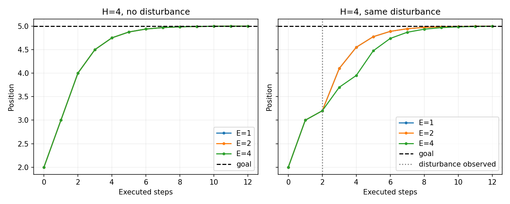

# 第四章——从单步动作到动作序列

第一章建立了闭环，第二章说明了动作的坐标系与单位，第三章让模型从示范中预测一个动作。本章保留这些约定，把输出扩展为一段动作序列，再学习如何根据反馈分段执行。**动作分块仍然可以通过第三章的行为克隆来学习，改变的是预测标签中多了一条时间轴。**

今天的目标是能解释：**一次预测多少步、实际执行多少步、什么时候重新观察和预测**。

## 1. 具体问题：为什么只预测下一步还不够方便

第三章的单步策略每次读取观察，然后产生一个动作。假如一个任务需要 100 次动作，逐步调用策略就需要 100 次预测。相邻动作还应协调，例如先靠近方块、再接触、再持续推动。

一种办法是：读取当前观察时，一次预测接下来的几步动作。这样能把连续操作作为一个整体来学习。若执行多步后才重新预测，还可以减少策略调用次数；若仍然每步重新预测，调用次数就不会减少。环境可能在执行期间变化，所以还要考虑何时根据反馈修正。

## 2. 直观解释：先想几步，走一小段，再看一眼

把动作序列想成一张短路线单：“向前一步、向前一步、向右一步、停下”。可以执行完四步再看环境，也可以只执行两步就重新观察，把剩余路线更新掉。

这个类比只解释执行顺序。机器人每一步的指令仍有第二章规定的语义：绝对位置、位移、速度等。**一个动作块里的多行动作必须按时间顺序执行，不能把它们相加后一次发送。**

## 3. 概念定义：动作块、预测时域与执行时域

**动作分块（action chunking）**指策略一次预测连续多个时间步的动作。这段序列称为**动作块（action chunk）**。

| 符号 | 中文、英文及用途 | 本章例子 |
| --- | --- | --- |
| $H$ | 预测时域（prediction horizon）：一次预测的动作步数 | 预测 4 步， $H=4$ |
| $E$ | 执行时域（execution horizon）：重新预测前执行的步数 | 只执行前 2 步， $E=2$ |
| $d_a$ | 动作维度（action dimension）：一个时间步有多少个控制量 | 一维位移为 1，PushT 目标坐标为 2 |
| $B$ | 批量大小（batch size）：一次计算的样本数量 | 两个样本， $B=2$ |

本章假设 $1\le E\le H$ 。执行前 $E$ 步后，用新的观察重新预测，旧块中剩余动作不继续使用。这个过程称为**滚动执行（receding-horizon execution）**。

例如 $H=4$ 、 $E=2$ ，表示“想四步，走两步，再想四步”。时域在这里按动作步数计算；若每步用时 0.1 秒，则预测覆盖 0.4 秒、执行覆盖 0.2 秒。实际系统还需要计入推理耗时和控制延迟，本章暂时忽略它们。

## 4. 数学与张量：增加的是时间轴

第三章单步策略的输出是：

$$
\hat a_t=\pi_\theta(o_t,g),\qquad \hat a_t\in\mathbb{R}^{d_a}.
$$

动作分块策略的输出变成：

$$
\hat A_t=\pi_\theta(o_t,g)
=\begin{bmatrix}
\hat a_{t\mid t}^{\mathsf T}\\
\hat a_{t+1\mid t}^{\mathsf T}\\
\vdots\\
\hat a_{t+H-1\mid t}^{\mathsf T}
\end{bmatrix}
\in\mathbb{R}^{H\times d_a}.
$$

其中 $t$ 是当前时间步， $o_t$ 是当前观察， $g$ 是目标， $\pi_\theta$ 是参数为 $\theta$ 的策略； $\hat a$ 上的帽子表示预测值。 $\hat A_t$ 是在时间步 $t$ 生成的动作块。下标 $t+h\mid t$ 表示“在 $t$ 时刻，对 $t+h$ 时刻动作的预测”， $h=0,\ldots,H-1$ 。上标 $\mathsf T$ 表示转置，让每个动作向量成为矩阵的一行。目标固定时，可与第三章一样省略输入中的 $g$ 。

| 数据 | 单个样本形状 | $B$ 个样本的形状 |
| --- | --- | --- |
| 观察（以五维观察为例） | `(5,)` | `(B, 5)` |
| 单步动作 | `(d_a,)` | `(B, d_a)` |
| 动作块 | `(H, d_a)` | `(B, H, d_a)` |

例如 PushT 的 $d_a=2$ ，一次预测 4 步、批量有 2 个样本，则输出形状为 `(2, 4, 2)`。三个轴依次是“样本、时间、动作分量”。每个样本中的一行动作仍是推杆的绝对目标坐标，增加时间轴不会把它改成位移。表格沿用第三章的五维状态观察；下面的一维原理环境使用更简单的当前位置与目标。

### 能手算的动作块

继续第一章的原理环境，当前位置 $x_0=2$ 、目标 $g=5$ ，动作是本步位移：

$$
a=\mathrm{clip}(0.5(g-x),-1,1),\qquad x_{\text{next}}=x+a.
$$

这里 $x$ 是当前位置， $g$ 是目标位置， $a$ 是本步位移， $x_{\text{next}}$ 是执行后的新位置，都是标量。`clip(value, -1, 1)` 表示把数值限制在 $[-1,1]$ ：小于 -1 取 -1，大于 1 取 1，其余保持原值。例如 $x=1$ 、 $g=5$ 时，未限幅的计算值为 $0.5(5-1)=2$ ，实际动作只能是 1。限幅约束的是**每一步动作**，不限制预测步数。

假设未来没有扰动，根据这条规则向前计算 4 步：

| 预测步 | 用于预测的位置 | 预测位移 | 预测下一位置 |
| --- | ---: | ---: | ---: |
| 0 | 2 | 1 | 3 |
| 1 | 3 | 1 | 4 |
| 2 | 4 | 0.5 | 4.5 |
| 3 | 4.5 | 0.25 | 4.75 |

因此 $\hat A_0=[1,1,0.5,0.25]^{\mathsf T}$ ，形状为 `(4, 1)`。这里用人工规则和简化状态转移计算未来动作，计算时没有推进真实环境；实际 ACT 则由网络根据输入直接预测动作块，不要求逐步模拟未来位置。

## 5. 示范数据怎样变成动作块

第三章每个样本的标签是专家单步动作 $a_t$ 。现在标签是同一条轨迹中从 $t$ 开始的 $H$ 个专家动作：

$$
A_t=\begin{bmatrix}
a_t^{\mathsf T}\\
a_{t+1}^{\mathsf T}\\
\vdots\\
a_{t+H-1}^{\mathsf T}
\end{bmatrix}
\in\mathbb{R}^{H\times d_a}.
$$

这里 $a_{t+h}$ 是专家在时间步 $t+h$ 的真实动作，没有帽子； $A_t$ 是训练标签， $\hat A_t$ 是模型预测。轨迹剩余动作足够时，标签对应代码 `episode_actions[t:t + H]`，形状为 `(H, d_a)`。

训练时用当前观察预测未来动作，再与专家动作块比较。**未来专家动作是训练标签，执行时不能当作输入读取。**先按完整回合划分训练、验证和测试，再从各自回合中取窗口；窗口不能跨越两个回合，延续第三章避免数据泄漏的做法。

回合末尾可能不足 $H$ 步。例如轨迹只剩一个动作 $0.0625$ ， $H=4$ 时可以补齐为 `[0.0625, 0, 0, 0]`，同时保存**有效掩码（valid mask）** `[1, 0, 0, 0]`。掩码的 1 表示真实标签、0 表示补齐位置；补齐位置不计入损失。真实动作也可能是 0，所以不能凭“动作是否为 0”判断它是否有效。

### 把第三章的 MSE 扩展到动作块

对于本章教学示例，带掩码的均方误差可以写成：

$$
L=\frac{\displaystyle\sum_{i=1}^{B}\sum_{h=0}^{H-1}\sum_{j=1}^{d_a}
m_{ih}(\hat A_{ihj}-A_{ihj})^2}
{\displaystyle d_a\sum_{i=1}^{B}\sum_{h=0}^{H-1}m_{ih}}.
$$

$L$ 是标量损失； $i$ 是样本编号， $h$ 是块内步数， $j$ 是动作分量编号。 $A$ 是专家标签， $\hat A$ 是预测，形状都是 `(B, H, d_a)`。 $m$ 是形状 `(B, H)` 的掩码， $m_{ih}\in\{0,1\}$ ，整个批量至少应有一个有效位置。分母只统计有效步数乘以动作维度；全都有效时，分母就是 $B H d_a$ 。

手算一个全部有效、 $B=1$ 、 $H=2$ 、 $d_a=1$ 的例子：专家动作是 `[1, 0.5]`，预测是 `[0.8, 0.4]`，误差为 `[-0.2, -0.1]`。所以：

$$
L=\frac{(-0.2)^2+(-0.1)^2}{2}=0.025.
$$

结果仍是一个标量，与第三章一致。MSE 是这里的教学选择，动作分块本身并不限定必须用 MSE。

## 6. 滚动执行：观察 → 预测一块 → 执行一段 → 再观察

$H=4$ 、 $E=2$ 时，先预测 `[1, 1, 0.5, 0.25]`，只执行前两步 `[1, 1]`。此时重新观察，重新生成未来 4 步，原来的 `[0.5, 0.25]` 被替换。

本章时间编号从 0 开始：第 1 个动作在 $t=0$ 执行，第 2 个动作在 $t=1$ 执行，之后的新观察用于决定 $t=2$ 的动作。若没有扰动，新观察为 $x=4$ ，重新预测得到 `[0.5, 0.25, 0.125, 0.0625]`。前两个数虽与旧块剩余动作相同，仍是根据新观察重新计算的结果。

假设第 2 个动作执行后，外部扰动把位置从 4 推回 3.2。用新观察计算的下一动作是：

$$
a_2=\mathrm{clip}(0.5(5-3.2),-1,1)=0.9.
$$

新块变为 `[0.9, 0.45, 0.225, 0.1125]`。如果坚持执行原动作块第 3 个动作，则仍是 0.5。这两个数的区别体现了第一章的反馈作用：**旧块被丢弃，新块的数值由新观察决定，可能相同，也可能不同。**

核心执行代码是：

```python
if not pending:
    chunk = predict_chunk(x, goal, H)     # (H, 1)
    pending = chunk[:E, 0].tolist()       # 只取前 E 步
action = pending.pop(0)                   # 本步只执行一个动作
x = x + action                           # 无扰动时的一维状态转移
```

这段代码展示执行队列；完整脚本还在状态转移中加入扰动。块内的 $E$ 步按原计划执行，块与块之间根据观察重新预测。环境每步都可以返回新观察，但本章的队列策略在重新预测时才用它更新动作块。实际机器人的底层位置控制器还可能每步使用反馈，这与高层策略每隔 $E$ 步调用一次是两层不同的控制过程。

## 7. ACT 怎样把这些概念变成学习策略

**ACT（Action Chunking with Transformers，使用 Transformer 的动作分块）**由 2023 年 ALOHA 工作提出，是学习动作序列的代表性模仿学习方法。**Transformer（变换器）**是一类以注意力机制组织信息的神经网络架构；ACT 用它融合视觉与机器人状态，并预测动作块。原始 ACT 的动作是关节目标位置，连接实际环境时必须核对动作定义。[原论文](https://arxiv.org/abs/2304.13705)

ACT 还使用**条件变分自编码器（Conditional Variational Autoencoder，CVAE）**：训练时将专家动作块编码为潜变量 $z$ ，帮助描述示范动作的变化；标准推理取 $z=0$ ，不读取未来专家动作。[作者项目说明](https://tonyzhaozh.github.io/aloha/)

实际代码使用 L1 重建损失（预测与标签绝对差的平均）和 **KL 散度（Kullback–Leibler divergence）**正则项（约束潜变量分布）。所以，本章的 MSE 动作块 Demo 只演示分块与执行机制，不能当作完整 ACT 的训练实现。[作者 policy.py](https://github.com/tonyzhaozh/act/blob/742c753c0d4a5d87076c8f69e5628c79a8cc5488/policy.py)

**时间集成（temporal ensembling）**是另一种执行方式：每个时间步都预测新动作块，将不同预测时刻对“同一个执行时刻”的动作进行加权融合。例如执行 $t=2$ 的动作时，可以融合 $t=0$ 的第 3 个预测、 $t=1$ 的第 2 个预测、 $t=2$ 的第 1 个预测。它融合的是同一时刻的候选动作，不能把三个相邻时刻的动作平均。LeRobot 开启该功能时要求每步调用策略；它与本章每隔 $E$ 步预测的队列方式不同。[官方实现](https://github.com/huggingface/lerobot/blob/main/src/lerobot/policies/act/modeling_act.py)

截至 2026-10-01 核查：原始 ACT 仓库未归档，属于维护较慢的经典实现；LeRobot 持续提供 ACT 实现和示例。可访问的官方权重 [act_aloha_sim_transfer_cube_human](https://huggingface.co/lerobot/act_aloha_sim_transfer_cube_human) 适配 ALOHA 搬方块环境，动作维度为 14，不能直接用于二维 PushT。我们将 ACT 用作本章代表性方法，贯穿推物项目仍以预训练扩散策略为主。[ACT 仓库](https://github.com/tonyzhaozh/act)、[LeRobot ACT 文档](https://huggingface.co/docs/lerobot/act)

本章 Demo 使用本机 CPU 和现有 NumPy、Matplotlib，无需云 GPU。完整 ACT 的训练或预训练推理留作选修，需另配与上游依赖匹配的环境：LeRobot v0.6.1 要求 Python ≥3.12，不能直接照搬本地第三章的 Python 3.11 配置。[版本依赖](https://github.com/huggingface/lerobot/blob/v0.6.1/pyproject.toml)

## 8. 代码 Demo：张量窗口与滚动执行

> **Demo 类型：原理演示。** 用第一章的人工专家生成动作块，没有训练 ACT。测试环境仍是一维位移模型。

完整代码：[demo/chapter04_chunks.py](demo/chapter04_chunks.py)。在章节所在目录运行：

```bash
python3 demo/chapter04_chunks.py
```

依赖为 Python 3.11.9、NumPy 2.3.1、Matplotlib 3.10.3。缺少依赖时，沿用第三章的虚拟环境安装：

```bash
python -m pip install numpy==2.3.1 matplotlib==3.10.3
```

脚本做两件事：从一条轨迹取两个动作窗口，打印形状和掩码；固定 $H=4$ ，分别执行 $E=1,2,4$ 步后重新预测。每种方式都运行无扰动和同一个 `-0.8` 扰动两种情形，总共 6 次确定性运行，每次 12 步。

掩码损失公式对应代码：

```python
squared = (prediction - target) ** 2       # (B, H, d_a)
loss = (squared * valid[..., None]).sum() / (valid.sum() * target.shape[-1])
```

`valid[..., None]` 在末尾加一维，从 `(B, H)` 变为 `(B, H, 1)`，使同一时间步的所有动作分量使用同一个掩码。脚本故意把补齐位置的预测设为 99，验证这些值不会影响有效步的损失。

实际运行得到：

```text
action_windows.shape = (2, 4, 1)
valid_mask = [[1, 1, 1, 1], [1, 0, 0, 0]]
masked_mse = 0.010000
```

这个 `0.01` 对应脚本中有效分量统一相差 `0.1` 的测试，与第 5 节的 `0.025` 手算使用不同预测值。

结果保存在 [results/chapter04/metrics.json](results/chapter04/metrics.json)，图表为 `results/chapter04/rollouts.png`。换参数复习时可另存结果，便于比对：

```bash
python3 demo/chapter04_chunks.py --disturbance 0.8 --output results/chapter04_positive
```

## 9. 结果解读：少调用策略与及时反馈之间的取舍



左图无扰动时，三条轨迹重合，因为人工专家能准确预测这个简化环境。右图中，各方式都在执行完第 2 步后受到同一个 `-0.8` 扰动；只改变执行时域 $E$ ，模型规则、 $H$ 、目标、动作上限和总步数保持相同。

| 执行时域 | 12 步中的策略调用次数 | 扰动后首次重新预测的 $t$ | $t=2$ 执行动作 | 扰动实验最终误差 |
| --- | ---: | ---: | ---: | ---: |
| $E=1$ | 12 | 2 | 0.9 | 0.001758 |
| $E=2$ | 6 | 2 | 0.9 | 0.001758 |
| $E=4$ | 3 | 4 | 0.5 | 0.004102 |

这里 $E=1$ 与 $E=2$ 的轨迹一致，是因为扰动恰好出现在 $E=2$ 的重新预测边界；换一个扰动时间，结果可能不同。 $E=4$ 用旧块执行第 3、4 个动作，到 $t=4$ 才修正。最终误差定义为 $\lvert g-x_{12}\rvert$ ，小于 0.1 视为成功；所有运行都满足本次标准。每种设置只运行一次，这是确定性原理对照，不用于估计真实机器人任务的成功率。

调用次数只说明重新预测的频率，没有测量真实大模型推理耗时。这个小实验也没有证明动作块越长越好：执行旧动作越久，环境变化越难及时影响后续决策；频繁重新预测则需要更多策略调用。真实学习策略还存在预测误差，第三章的分布偏移依然需要评测。

## 10. 小练习（全章共 3 题）

三题分别对应第 4 节的张量形状、第 6 节的滚动执行，以及第 4、6 节的限幅与反馈。概念沿用正文，只调整数值。

1. 一次预测 4 步，每步动作是两个坐标，批量有 **3 个样本**。动作块张量形状是什么？说明三个轴各代表什么。
2. 给定一个动作块 `[1, 1, 0.25, 1]`， $H=4$ 、 $E=2$ 。先执行哪些动作？执行两步后，剩余的 `[0.25, 1]` 怎么处理？新块的前两个数必须还是 `[0.25, 1]` 吗？这里的动作块是人为给定，只考执行规则，不要求用专家公式生成它。
3. 重新观察得到当前位置 $x=2.1$ 、目标 $g=6$ 。沿用 $a=\mathrm{clip}(0.5(g-x),-1,1)$ ：先算未限幅的值，再给出**实际执行的动作**。如果继续执行旧块的下一动作 0.25，哪种方式更早利用了最新观察？提示：动作仍须在 $[-1,1]$ 内。

### 参考答案（先独立作答，再展开）


### 查看三题参考答案


1. `(3, 4, 2)`。三个轴依次是 3 个样本、4 个预测时间步、每步 2 个动作分量。执行时域 $E$ 不改变预测动作块的形状。
2. 先按顺序执行 `[1, 1]`。两步后用新观察重新预测，旧块剩余的 `[0.25, 1]` 被丢弃。新块不必以 `[0.25, 1]` 开头；即使数值恰好相同，也应来自新观察下的预测。
3. 未限幅的值为 $0.5(6-2.1)=1.95$ ，大于动作上限 1，因此实际动作为 $\mathrm{clip}(1.95,-1,1)=1$ 。重新预测的方式更早把最新观察用于后续动作。反馈不能撤回已经执行的动作，也不保证一次就到达目标。


## 11. 来源与许可

- [ACT 原论文：Learning Fine-Grained Bimanual Manipulation with Low-Cost Hardware](https://arxiv.org/abs/2304.13705)：动作分块、CVAE 与时间集成的出处，RSS 2023。
- [作者项目页](https://tonyzhaozh.github.io/aloha/)与[原始代码](https://github.com/tonyzhaozh/act)：ACT 模型、训练和仿真示例；代码采用 MIT 许可证。
- [LeRobot ACT 文档](https://huggingface.co/docs/lerobot/act)、[配置代码](https://github.com/huggingface/lerobot/blob/main/src/lerobot/policies/act/configuration_act.py)：`chunk_size` 与 `n_action_steps` 对应本章的 $H$ 和 $E$ ；项目采用 Apache-2.0 许可证。
- [GitHub 数学表达式文档](https://docs.github.com/en/get-started/writing-on-github/working-with-advanced-formatting/writing-mathematical-expressions)：行内公式使用 `$...$`，公式块使用独立成行的 `$$`，两侧留空行，避免被解析为普通文字或代码。

本章一维计算、Demo 和图表为本教程编写及运行生成，没有复制上游模型实现或下载权重。第五章会继续使用动作块表示，学习 Diffusion Policy 如何通过条件去噪产生整段动作。
